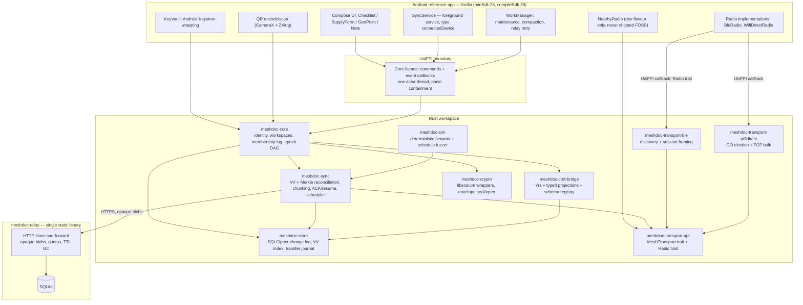
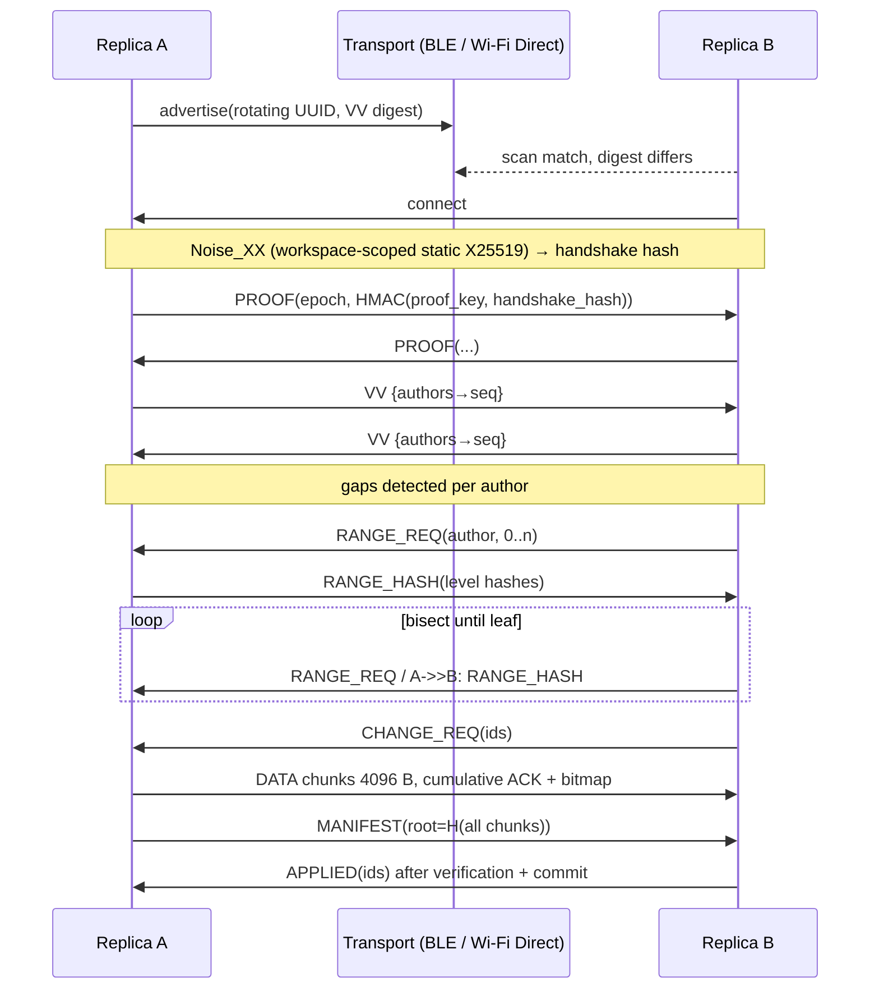

# MeshDoc — Technical Case

**Status:** engineering research input. This is *not* proposal prose and must not be pasted into the NLnet application form (GenAI policy v2.0); it exists so the applicant can write the submission in their own words with correct numbers and no overclaims.
**Scope of this document:** architecture, rejected design alternatives, the hard problems, measurable acceptance criteria, risk/fallback analysis, and a 12-month plan. It assumes the project starts from zero code.
**Companion documents:** `BUDGET_AND_MILESTONES.md` owns absolute euro figures and rates; this document owns work-package structure, effort in person-months, and the share of the request allocated to each tranche. `LANDSCAPE.md` owns prior art.

**Conventions:** claims that could not be verified from a primary source at writing time are marked **[UNCERTAIN]**. Thresholds in §4 are pre-registered: they are not moved after measurement. "Change" means the signed, encrypted CRDT diff described in §2.3; it is the only object that ever travels on any wire.

**Reading map:** §1–§2 are the architecture and design-decision material (feeds the "comparison with other efforts" and "effort" fields); §3 is the raw material for the "technical challenges" field; §4 and §6 are the evidence and the plan (feeds "effort and budget" and "milestones"); §5 is the risk/fallback honesty; §7 lists what must be checked before any claim is made. The applicant should rewrite all of it in their own words.

**AI exclusion.** There is no AI component anywhere in the funded scope: no models, no weights, no inference, no training data, no generative feature. The only forward-looking mention permitted is one design-property sentence — the typed document format is versioned, so a future *separate* view-layer effort (e.g. translation) could be added without touching stored data. It is not a deliverable here.

---

## 0. Design invariants

These are the constraints every subsystem is checked against. They are numbered so the acceptance criteria and the challenge section can cite them.

| # | Invariant | Enforced by |
|---|---|---|
| I1 | A change is the only wire object; the same bytes are used over BLE, Wi-Fi Direct and the relay. Transport never re-encodes content. | `meshdoc-types` envelope + transport codec tests |
| I2 | `workspace_id` is an independent 128-bit random value created once at genesis; it is never derived from any key, and key rotation never changes it. | `meshdoc-core` creation path + tests (this is a correction to the original spec, see §2.3) |
| I3 | Membership is an authenticated append-only log. Possession of an epoch key grants *decryption*; authorization to write is decided by the membership log at the change's causal point. | `meshdoc-membership` |
| I4 | Causal order comes only from version vectors (and hybrid logical clocks for *display*). Wall-clock time never influences merge or authorization. | `meshdoc-sync`, fuzz schedule with ±400-day skew |
| I5 | Replica state is a deterministic function of the applied change set; delivery order, duplication, partition shape and clock skew do not affect the final canonical projection. | `meshdoc-sim` convergence oracle |
| I6 | Everything at rest is ciphertext. No plaintext workspace content reaches disk, logs, backups or crash reports. | SQLCipher + log redaction tests + `dataExtractionRules` |
| I7 | The FOSS flavour has no Google/Play Services dependency and is buildable from source with vendored crates and a pinned NDK; it passes F-Droid's reproducibility check. | CI reproducibility job, §4 AC-15 |
| I8 | Every wire object is versioned; unknown fields are preserved; a change whose `min_reader` exceeds the local reader is quarantined (stored and relayed), never reinterpreted. | `meshdoc-crdt-bridge` schema registry |
| I9 | Every parser has hard size and work bounds; hostile input cannot cause unbounded allocation or non-progress. | cargo-fuzz targets, §4 AC-12 |
| I10 | Deletion/GC never silently destroys user-visible history; compaction is a documented, user-visible policy with a snapshot fallback. | §2.2, §3(d), AC-11 |

---

## 1. Architecture

### 1.1 Component diagram



The radio *APIs* live in Kotlin because Android's BLE and Wi-Fi Direct are Java framework APIs with no stable NDK surface. Rust owns the security state machine, framing, retry, scheduling and energy policy; Kotlin implements a narrow `Radio` trait (`start_advertising`, `start_scan`, `connect`, `send`, `close`) exposed through UniFFI callbacks. That keeps the Rust crates platform-neutral (a Linux node exists for the simulator and field tests) and confines OEM quirks to one file per radio.

### 1.2 Crate layout

All crates share one Cargo workspace, one `Cargo.lock`, one `cargo vendor/` tree, SPDX headers and `reuse lint` compliance. Licence: EUPL-1.2 for the whole stack (copyleft, EU-flavoured, no mixed-licence friction between library and relay); Apache-2.0 is the fallback if a downstream commercial integrator objects, and the decision must be recorded once in the proposal. Dependencies are all permissive and F-Droid-compatible: libsodium (ISC), SQLCipher (BSD-3), Yrs (MIT), UniFFI (MPL-2.0, file-level), rusqlite (MIT), axum/tokio (MIT), snow (MIT/Apache-2.0).

| Crate | Responsibility | Key deps | Target LOC (excl. tests) |
|---|---|---|---|
| `meshdoc-types` | IDs, version vectors, HLC, canonical CBOR, error taxonomy, change envelope codec | serde, ciborium | ~0.8k |
| `meshdoc-crypto` | Ed25519ph sign/verify, X25519 ECDH, XChaCha20-Poly1305, BLAKE2b, HKDF-SHA256, key wrapping, deterministic nonces | libsodium-sys | ~0.7k |
| `meshdoc-identity` | seed handling, per-workspace key derivation, QR ticket codec, KeyVault trait | `meshdoc-crypto` | ~0.5k |
| `meshdoc-membership` | signed membership log, causal membership views, epoch DAG, rotation commits, equivocation detection | `meshdoc-crypto` | ~1.1k |
| `meshdoc-crdt-bridge` | Yrs wrapper, four typed projections, unknown-field preservation, schema registry, read adapters, canonical projection hash | yrs, serde | ~1.8k |
| `meshdoc-store` | SQLCipher schema, change log, VV index, epoch key storage, transfer journal, compaction | rusqlite (bundled-sqlcipher), zeroize | ~1.4k |
| `meshdoc-sync` | VV exchange, per-author Merkle-range reconciliation, change requests, 4 KiB chunking, ACK/resume, gossip policy, fairness scheduler, relay client | `meshdoc-*` core crates | ~2.2k |
| `meshdoc-transport-api` | `MeshTransport`, `Radio`, `Peer`, `TransportEvent`, backpressure, MTU adaptation | async-trait | ~0.3k |
| `meshdoc-transport-ble` | rotating-UUID discovery, digest advertisements, BLE session framing, reconnect state machine | `meshdoc-transport-api` | ~1.0k |
| `meshdoc-transport-wifidirect` | GO election, group lifecycle, TCP bulk channel, mDNS-free handshake | `meshdoc-transport-api` | ~0.9k |
| `meshdoc-radio-android` (Kotlin) | `BleRadio`, `WifiDirectRadio`, permissions, foreground service, Doze handling | Android SDK | ~1.8k Kotlin |
| `meshdoc-nearby` (dev flavour) | Nearby Connections adapter behind `MeshTransport`, excluded from FOSS build | Play Services | ~0.3k Kotlin |
| `meshdoc-ffi` | UniFFI interface, actor facade, panic containment, event fan-out | uniffi | ~0.7k |
| `meshdoc-relay` | HTTP blob store, capability mailbox, quotas, TTL GC, rate limits, metrics | axum, rusqlite | ~0.9k |
| `meshdoc-sim` | discrete-event simulator, fault injector, schedule generator, reference oracle | — | ~1.6k |
| `meshdoc-fuzz` | envelope parser, sync frame parser, reconciliation, projection adapters | cargo-fuzz | ~0.5k |
| `meshdoc-cli` | headless node, relay runner, benchmark driver, field-test console | clap | ~0.7k |
| `meshdoc-android` (Kotlin) | Compose app, four document screens, join flow, sync status, accessibility | AndroidX, Compose | ~3.4k Kotlin |

These are production LOC ceilings, not targets to hit; tests add roughly 50 % on top and are included in the WP effort estimates in §6.1. Total production code ≈ 20.6k LOC across Rust and Kotlin.

Dependency rule: `meshdoc-types` and `meshdoc-crypto` are leaves; nothing below `meshdoc-sync`/`meshdoc-core` reaches into the FFI or Android crates; the simulator links the same `meshdoc-sync`/`meshdoc-crdt-bridge`/`meshdoc-store` code as production, with `meshdoc-store` using plain SQLite instead of SQLCipher under a test feature. **The simulator must not reimplement protocol logic** — that is the main defence against a fuzz oracle that validates a fiction.

### 1.3 FFI boundary

UniFFI, proc-macro mode, one exported `Core` object plus callback interfaces. The boundary is deliberately *coarse*: commands, not property access, so that no Rust borrow or lock is held across a JNI call.

```
interface Core {
  create_workspace(display_name: String, profile: WorkspaceProfile) -> WorkspaceHandle;
  join_from_qr(ticket: QrTicket) -> WorkspaceHandle;
  list_workspaces() -> Vec<WorkspaceSummary>;
}
interface WorkspaceHandle {
  apply_edit(doc_id: DocId, edit: EditRequest) -> EditOutcome;       // fast, <2 ms p99
  read_doc(doc_id: DocId, page: Page) -> DocView;                    // paged projection, page ≤ 256 KiB
  sync_now(reason: SyncReason) -> SyncTicket;                        // schedules; non-blocking
  relay_flush() -> RelayTicket;
  membership() -> MembershipView;
  remove_member(member: MemberId) -> EpochCommitView;
  rotate_keys(reason: RotationReason) -> EpochCommitView;
  export_archive(path: String) -> ArchiveInfo;                       // encrypted, user-initiated
  close();
}
callback interface CoreEvents {
  on_doc_changed(event: DocChanged);
  on_peer_event(event: PeerEvent);          // discovered / connected / failed(transport, oem_hint)
  on_sync_progress(event: SyncProgress);
  on_error(event: CoreError);
}
callback interface Radio { ... }              // implemented by Kotlin
callback interface KeyVault { ... }           // Keystore wrap/unwrap
```

Threading: one dedicated **core actor thread** owns all mutable state. FFI commands enqueue a command plus a `oneshot` reply; Kotlin calls them from `Dispatchers.IO`; events fire on a separate event thread and are delivered into a `Channel` that the app drains into a `StateFlow`. Rationale: no locks across FFI, deterministic ordering, panic containment, and easy crash reporting. Costs: one hop of latency (~0.1 ms) and an explicit command enum — acceptable for edits that are debounced at 250 ms anyway.

Failure semantics:
- `catch_unwind` at every exported function; any panic becomes `CoreError::Internal`, the handle enters **fail-closed** mode (read-only, refuses edits, exports a diagnostic bundle), and the app shows a recoverable error. `panic = "abort"` is **not** used for the Rust core because it would kill the whole app process; instead the core is built with `panic = "unwind"` and `-C panic=abort` only for fuzz targets.
- UniFFI checks a generated checksum at load; a stale Kotlin/Rust pair fails immediately with a version error rather than corrupting state.
- No Rust pointer or borrow escapes; all strings/bytes are copied. Memory budget at the boundary is bounded by size caps: one `DocView` page is capped at 256 KiB (a 10 k-item checklist is read in pages) and a `ChangeBatch` at 64 KiB.
- Kotlin keeps no business logic: validation of *intent* (e.g. field type) happens in `meshdoc-crdt-bridge`, so the same rules apply headless.

Versioning: `proto_min`/`proto_max` in the handshake; app and core versions are recorded in every diagnostic trace; downgrade is unsupported (clear error, local data untouched).

### 1.4 On-disk model

One SQLCipher 4 database per device (single file, WAL, `secure_delete=ON`, `temp_store=MEMORY`, `cipher_memory_security=ON`). Keys: a random 32-byte DB key wrapped by a non-exportable Android Keystore AES-256-GCM key; the wrap is stored in `EncryptedSharedPreferences`-equivalent app storage. The DB is never opened before `ACTION_USER_UNLOCKED` (credential-encrypted storage is unavailable prior to first unlock); the foreground service may advertise while locked but performs no DB access.

| Table | Columns (abridged) | Purpose |
|---|---|---|
| `changes` | `id BLOB PK, ws_id, author, prev_hash, seq, epoch, kind, schema_ver, min_reader, doc_id, deps BLOB, header BLOB, ciphertext BLOB, sig BLOB, received_at` | authenticated change log; ciphertext only |
| `vv` | `ws_id, author, seq, PRIMARY KEY(ws_id,author)` | materialized version vector |
| `docs` | `doc_id PK, ws_id, kind, snapshot BLOB, snapshot_vv BLOB, schema_ver, updated_at` | compacted projection |
| `members` | `ws_id, member_pub, x25519_pub, role, status, added_by, added_seq` | materialized membership view |
| `membership_log` | `entry_hash PK, ws_id, author, seq, payload, sig` | hash-chained membership entries |
| `epochs` | `ws_id, epoch PK, parent_commit, commit_hash, wrapped_key BLOB, recipients BLOB, created_at` | epoch private keys (wrapped) + recipient set |
| `pending` | `id PK, ws_id, change BLOB, missing_deps BLOB` | changes buffered until causally ready |
| `transfers` | `peer, direction, transfer_id, offset, total, root_hash, updated_at` | resume from last ACK |
| `relay_cursors` | `mailbox PK, cursor, last_ok, failures` | relay polling state |
| `peers` | `peer_id PK, last_seen, transport, rssi_hint, failures` | discovery cache, backoff |
| `diag` | ring buffer of 512 redacted events | crash/field diagnosis, no content |

There is no plaintext index of document content; search in v1 is over the in-memory projection only. Backups are disabled (`android:allowBackup="false"` and `dataExtractionRules` excluding the DB and key wrap); the only backup path is an explicit, password-protected encrypted archive export.

### 1.5 The six key paths

| Path | Trigger | Steps (state changes in order) | Wire objects | Failure handling |
|---|---|---|---|---|
| **P1 Create workspace** | User taps "New workspace" | 1. Ensure device seed; derive identity. 2. Draw `ws_id` = 16 random bytes. 3. Draw epoch-0 key = 32 random bytes. 4. Build genesis change: workspace name, self membership entry (workspace-scoped pubkeys), epoch-0 commit with key wrapped to self, empty document roots, `schema_ver=1`. 5. Sign, encrypt, commit atomically (change + `epochs` + `vv` + `docs`). 6. Derive mailbox-0; render QR ticket. No network. | none (local) | CSPRNG failure aborts creation (never falls back); Keystore failure → user-visible "device not supported" without writing keys to disk |
| **P2 Join by QR** | User scans ticket | 1. Decode CBOR, check length/CRC/version. 2. Create DB; import `ws_id`, epoch key(s), inviter pubkey, relay list. 3. Write self membership entry signed by workspace-scoped key, binding an unlinkable identity commitment. 4. Connect (peer or relay); Noise handshake + epoch proof; exchange VVs. 5. Fetch membership log + changes; verify genesis, chain, authorization-at-causal-point. 6. Apply topologically. Read-only until verification completes; on failure wipe the partial DB. | QR ticket (~150 B), handshake, VV, membership/change batches | Any verification failure → workspace not unlocked, explicit error; partial state wiped; replay of an old QR is detected by `epoch`/membership state |
| **P3 Local edit** | UI mutation (debounced 250 ms) | 1. Typed validation against schema. 2. Yrs transaction (set field, add item with fractional index, toggle, append text). 3. Encode update. 4. Build envelope; deterministic nonce; XChaCha20-Poly1305; Ed25519ph sign. 5. Single DB transaction: change row + doc snapshot delta + VV bump + outbox. 6. Emit `DocChanged`; refresh discovery digest (rate-limited to 30 s); schedule gossip. | local only until a peer/relay contact | Crash between steps → transaction rollback, no half-change; oversize edit → split into multiple changes; schema validation failure → UI error, no change |
| **P4 Peer sync** | Discovery match + digest different, or user "Sync now" | 1. Discovery via rotating UUID; read the 4-byte keyed VV digest from the scan response; skip connect if equal. 2. Connect (BLE GATT custom service, or Wi-Fi Direct TCP). 3. Noise `XX` with workspace-scoped static X25519 keys; epoch proof; membership check. 4. Exchange VVs. 5. For each author with a gap: Merkle-range exchange → missing (author, seq, hash). 6. Request bodies; transfer in 4 KiB chunks, cumulative ACK, resume journal. 7. Per change: verify sig → check author membership at causal point → check epoch → decrypt → check `min_reader` → buffer until deps satisfied. 8. Commit; update VV; gossip new heads; optionally upload to relay. | handshake frames, VV, range hashes, change bodies | Any failed verification drops the change (no state change), records peer fault, continues; untrusted length → connection aborted; disputed epoch → epoch DAG sync first |
| **P5 Relay sync** | No peer reachable; periodic maintenance | 1. Derive mailbox for current and previous weekly bucket. 2. `POST` local changes absent from relay (batched ≤64 KiB, size-class padded). 3. `GET` manifest since cursor. 4. Download blobs; same verification pipeline as P4. 5. Persist cursor; relay GC by TTL. 6. Exponential backoff 30 s → 1 h with jitter, gated by energy policy. | HTTPS blobs | Relay unreachable → queue, retry; TTL near expiry → UI warns "not yet propagated"; corrupted blob → discard, re-request once from a peer |
| **P6 Member removal** | Admin removes a member | 1. Author signed `RemoveMember` change (admin role checked at causal point). 2. Compute epoch E+1: fresh 32-byte key; recipients = active members at the causal point minus target. 3. Wrap new key per recipient with ephemeral-static X25519 ECDH → HKDF → XChaCha20-Poly1305. 4. Author `EpochCommit` (parent commit hash, recipient list, wrapped keys), signed. 5. Switch local content key; publish to remaining peers and mailbox E+1. 6. Peers validate admin + recipient set; switch, or record an epoch fork and later emit a merge epoch. | membership change, epoch commit, wrapped keys | Concurrent rotations during partition → epoch DAG, merge epoch (union of recipients, fresh key); removed member's writes rejected after the causal point; removed member retains read access to all old-epoch content (documented, not fixable) |

Sequence for P4 (the path reviewers will probe hardest):



### 1.6 Platform matrix and build outputs

- `minSdk 26` (Android 8.0) because BLE extended advertising and `startAdvertisingSet` arrive at API 26; `targetSdk` tracks the latest stable (36 at writing time). Wi-Fi Direct exists since API 14; `FEATURE_WIFI_DIRECT` is checked at runtime.
- Two product flavours: `foss` (F-Droid, no Play Services, no Nearby, reproducible) and `dev` (adds Nearby Connections for the developer loop; **not shipped**, not part of the grant deliverable). A future `gms` flavour is not planned.
- Rust targets: `aarch64-linux-android`, `armv7-linux-androideabi`, `x86_64-linux-android` (emulator), plus `x86_64-unknown-linux-musl` for the relay and headless node. Built with `cargo-ndk`, pinned NDK, `cargo vendor` and `--offline` in the F-Droid recipe.
- Accessibility is a deliverable, not a nice-to-have: TalkBack-complete flows, 48 dp targets, contrast ≥ 4.5:1, no drag-only interactions, and an NLnet free accessibility scan scheduled before release (M12 gate).

---

## 2. Key design decisions

### 2.1 ADR-1 — CRDT substrate: Yrs (Yjs in Rust), behind a projection bridge

#### Alternatives

| Criterion | Automerge 2.x (Rust) | Yrs (Yjs) | Loro | Build our own |
|---|---|---|---|---|
| Model | JSON-like maps/lists/text/counters; change DAG with hashes | JSON-like `Any`; YATA list; text | JSON-like containers; version vectors/frontiers; movable list | — |
| Sync primitive | Change-hash DAG; sync uses Bloom-filter summaries in `automerge-repo` (JS); Rust exposes `save_incremental` | State vector + update encoding v1/v2: **exact** delta, two-message handshake, no probabilistic structure | Version-vector/frontier diff; snapshot and shallow-snapshot export | — |
| Wire efficiency | Columnar, good for history-heavy docs; change hashes cost 32 B per node | Very small updates for small edits; designed for high-frequency editing | Competitive; strong perf claims | — |
| Typed schema | None; serde view on top | None; `Any` view on top | Container schema-ish, still untyped at wire level | Full control, unbounded work |
| Compaction / GC | `save()` produces a compact full document; loses fine-grained history unless retained | Deleted content GC optional; structural tombstones persist; no built-in history compaction | Snapshot + shallow snapshot; explicit GC | Must design tombstone GC from scratch |
| Schema-evolution hooks | None built in | None built in | None built in | Must design and prove |
| Maturity / bus factor | Active, Ink & Switch, used in production; Rust API still moving | Port of Yjs used by millions of JS deployments; extensive upstream test suite; stable Rust API | Younger, smaller ecosystem, strong momentum; API still moving | Research project risk |
| Licence | MIT | MIT | MIT | — |
| Main risk for us | Bloom-based sync adds probabilistic rounds; history model encourages unbounded growth; Rust API churn | Untyped data, tombstones, no compaction — all on us | Maturity/bus factor; fewer independent deployments | Correctness proofs + ecosystem + interop = multi-year |

#### Decision

**Yrs**, wrapped by `meshdoc-crdt-bridge`, with a **benchmark gate at M1** and Loro as the pre-agreed fallback (Automerge second fallback). Rationale, in order:

1. **Exact sync.** Yrs's state-vector update diff is exactly the primitive our anti-entropy design needs (§2.2); it avoids Bloom-filter false positives and the extra reconciliation round they force on a 4 KiB-chunk, high-loss link. Automerge's Bloom sync is a good design, but it exists to avoid exchanging full state vectors when the change graph is irregular; our per-author sequence numbers make VV exchange O(members) bytes.
2. **Update size.** For the workloads that dominate MeshDoc (toggles, field sets, short text appends), Yjs update encoding is among the smallest; this directly buys latency and battery.
3. **Maturity of the algorithm.** YATA (Yjs) has the largest real-world deployment and test corpus of the four; we inherit that confidence for the hard part (concurrent list ordering) while supplying our own typed layer and compaction policy.
4. **No JS runtime.** Yrs is a native Rust dependency; no Node, no wasm, no bridge.
5. **The weaknesses are addressable by us.** Untyped data is fixed by the projection layer; tombstones by snapshot checkpoints plus a retention window (§2.2, §3(d)); schema evolution by the rules in §2.1 (R1–R7). None of them requires modifying Yrs internals, which keeps us upgradable.

The M1 gate is a hard stop, not a formality. Workloads: (W1) 1 000-item checklist, 10 000 toggles/inserts; (W2) 200-field supply form, 5 000 field sets; (W3) 5 000 geo points appended; (W4) 20 KiB note, 2 000 text inserts; (W5) 90-day partition replay, then merge; (W6) late join of a 10 000-change workspace. Measurements: apply throughput, update bytes p50/p95, snapshot save/load time, memory, correctness on the small-scope exhaustive oracle. Pass thresholds: ≥ 20 k single-core small-op applies/s, update ≤ 1.3× the best candidate, snapshot round-trip byte-stable across processes, zero divergence on the exhaustive suite. If Yrs fails, Loro is adopted without changing any other crate (the bridge's API is candidate-agnostic).

#### Typed projections and schema migration across months-long partitions

The bridge exposes four document types with explicit Rust types and validates them on read; the underlying Yrs map remains the source of truth so that unknown fields survive. Key rule: **the projection never reconstructs the document from the typed struct**. It patches and reads individual keys in place, preserving every key it does not know (I8). Without this, a v1 client re-saving a v2 document would silently erase v2 fields — the classic failure mode for typed views over CRDTs.

- `Checklist`: map `items: Map<ItemId, {text, checked, assignee, order, updated_hlc}>`, plus `title`, `notes`. Ordering is a **fractional index string** (e.g. `a0`, `a0V`, `a1`) stored per item and compared lexicographically, not a CRDT list of items. This avoids Yjs's missing `move` operation and the tombstone storm a delete+reinsert would cause on every reorder.
- `SupplyForm`: `fields: Map<FieldId, {type, value, unit, updated_hlc}>` with a form schema (field descriptors, validation rules, enums) in a separate `_schema` map; derived totals are computed, never stored, to avoid conflicts in derived state.
- `GeoPoint`: `{lat, lon, alt, accuracy, label, updated_hlc}` as LWW registers plus an optional append-only track (`Map<seq, Point>`) for breadcrumbs.
- `Note`: `Y.Text` with a restricted mark set (bold/italic/code/list) mapped to a delta view; rich-text embedding is a non-goal for v1.
- Every document root carries `_meta: {schema_ver, kind, created_hlc, min_reader}`. `kind` is immutable.

**Schema-evolution rules** (the part that must commute with merge, see challenge (k)):

- R1 additive-only within a major version: add optional fields; never renumber, delete-and-reuse, or change the meaning of an existing key;
- R2 unknown-field preservation, as above;
- R3 read adapters are permanent: v1 readers are never deleted from the codebase; migration is a read-time fold (v1→v2 view) plus write-time upgrade, never a destructive rewrite of old operations;
- R4 a representational change (scalar → object) is done as a *new field* + dual-write + background copy, so replicas on either version merging in any order yield the same projection — this is the merge-commutation property we test (not assume);
- R5 each change carries `schema_ver` and `min_reader`; a reader below `min_reader` **quarantines** the change (stores it, relays it, does not apply or reinterpret it) and marks the document "update required";
- R6 a genuinely breaking change gets a new `kind` and an explicit user-visible "migrate document" operation producing a new document; the old one is archived, not silently mutated;
- R7 protocol and data schema versions are separate: the handshake negotiates transport/protocol; the document schema rides inside the change.

The honest limitation: forward compatibility requires discipline, and a v1 client cannot *interpret* a v2 field it does not know. It can preserve it, relay it, and keep writing v1 fields. That is the contract; anything stronger requires freezing all field semantics forever.

### 2.2 ADR-2 — Sync: version vectors + per-author hash chains + Merkle range reconciliation

#### Alternatives

| Approach | Cost per sync | Exact? | Weakness |
|---|---|---|---|
| Full state exchange | O(total state) | yes | impossible at 4 KiB chunks / 50 kbps; wastes energy |
| Delta from last-known VV (Yjs step1/step2) | O(diff) + one VV | yes | needs per-peer VV state (small, fine); no notion of *where* a gap is if local log is inconsistent; a single corrupted/lost prefix is invisible |
| Full change-hash set exchange | O(#changes) per contact | yes | prohibitive after months; O(n) hashes each sync |
| Bloom filter summary | O(1) message | **no** (false positives) | sender omits changes the receiver lacks; extra round; behaviour degrades exactly when the diff is large (the case that matters); parameter tuning per contact |
| IBLT | O(d) with ~1.5× overhead | probabilistically exact | requires knowing/estimating d; decode failure loops; large diff (new joiner) degenerates to full state; implementation risk for marginal benefit |
| Merkle tree over a total order | O(d log n) hashes | yes | needs a canonical total order; a change DAG has none |

#### Decision

Two-layer reconciliation:

1. **Version vector** per workspace: `VV = {author → max contiguous seq}`. Every change has a per-author, per-workspace sequence number; the author maintains a hash chain (`prev_hash` binds seq n to seq n−1). A VV is therefore an *exact* statement of what a replica has, provided the replica only advances a seq when all prior seqs are present (enforced: apply in causal order, buffer until ready). Cost: ~6 bytes per author; a 20-member workspace exchanges ~140 bytes each way.
2. **Per-author Merkle range reconciliation** (range-based set reconciliation, Meyer 2023, restricted to the ordered per-author chain) for the case where a VV gap exists and we need to find *which* changes are missing without shipping the whole range. Both sides hash aligned ranges with fanout 8 (leaf = change hash; internal = H of child hashes), compare from the top, bisect only mismatching ranges. Cost O(d · log₈ n) × 32 B, where d is the number of differing leaves. For one missing change in 10 000: ~5 hashes ≈ 160 B instead of 10 000 ids.
3. **Bodies** are requested by change id (32 B each), then transferred in 4 KiB chunks.

Why not IBLT: we *know* the difference size from the VV before reconciling, and the VV+chain removes the need for probabilistic summaries. IBLT would add a failure mode (decode failure → retry with different parameters) to save bytes in a case we have already made cheap. Why not Bloom: false positives cause *missed* changes, which must be detected and retried — on an intermittent mesh that is precisely the wrong failure mode; and Automerge's own Bloom sync is designed for a change DAG where VVs are unavailable, which is not our case.

Equivocation handling: an author can sign two different changes with the same `(author, seq)` (buggy client, or malice). We never pick "first seen" (that diverges). Both are stored and applied (the CRDT merges them), the chain leaf becomes `H(sort(hash₁, hash₂))`, and the peer is flagged; the UI shows an integrity warning. This keeps convergence under Byzantine *equivocation* without pretending to solve Byzantine consensus.

#### Wire format sketch

Change envelope (all little-endian; `d` = number of dependency entries):

| Offset | Size | Field | Notes |
|---|---|---|---|
| 0 | 1 | `ver` = 0x01 | |
| 1 | 1 | `kind` | 1 Genesis, 2 Edit, 3 Membership, 4 EpochCommit, 5 Snapshot |
| 2 | 16 | `ws_id` | random, never key-derived (I2) |
| 18 | 4 | `epoch` | u32 |
| 22 | 32 | `author` | workspace-scoped Ed25519 public key |
| 54 | 32 | `prev_hash` | previous change of this author; zeros for seq 1 |
| 86 | 8 | `seq` | u64 |
| 94 | 2 | `schema_ver` | |
| 96 | 2 | `min_reader` | |
| 98 | 16 | `doc_id` | |
| 114 | 1 | `flags` | bit0 Yrs update v2, bit1 snapshot body, bit2 relay-only blob |
| 115 | 2 | `dep_count` = d | |
| 117 | 10·d | `deps` | `(member_idx u16, seq u64)` compressed version vector |
| 117+10d | 4 | `payload_len` | u32, plaintext length |
| 121+10d | 24 | `nonce` | deterministic: `HMAC-SHA256(content_key, "nonce"‖author‖epoch‖seq)[:24]` |
| 145+10d | payload_len+16 | ciphertext | XChaCha20-Poly1305, AAD = bytes `[0, 121+10d)` |
| … | 64 | `sig` | Ed25519ph over BLAKE2b-256(header‖nonce‖ciphertext) |

`change_id = BLAKE2b-256(header‖nonce‖ciphertext)` — signed, so the signature is not part of the identity (re-signing the same bytes is idempotent). Typical small edit: payload ~120 B, d = 8 → **425 B**; max change 64 KiB → 16 chunks. Deterministic nonces remove RNG-failure risk and make snapshot tests reproducible; safety relies on `(author, epoch, seq)` never repeating, which the append-only log enforces.

Sync frames (after the Noise handshake; transport-agnostic, length-prefixed; BLE fragments frames across 244-byte GATT notifications, Wi-Fi Direct carries them over TCP):

| Type | Frame | Fields |
|---|---|---|
| 0x10 | `PROOF` | `epoch u32, tag[32]` = HMAC(proof_key, handshake_hash‖epoch) |
| 0x11 | `VV` | `n u16, [(member_idx u16, seq u64)]`, plus unknown-author pubkeys |
| 0x12 | `RANGE_REQ` | `author u16, lo u64, hi u64, fanout u8, depth u8` |
| 0x13 | `RANGE_HASH` | `author u16, lo u64, hi u64, hashes[32]` |
| 0x14 | `LEAF_REQ` | `n u16, [(author u16, seq u64)]` |
| 0x15 | `LEAF_HASH` | `n u16, [(author u16, seq u64, hash[32])]` |
| 0x16 | `CHANGE_REQ` | `n u16, ids[32]` |
| 0x20 | `DATA` | `transfer_id u64, chunk_idx u32, chunk_count u32, payload ≤4096, tag[16]` (AEAD nonce = transfer_id‖chunk_idx) |
| 0x21 | `ACK` | `transfer_id u64, cumulative_offset u32, bitmap[8]` |
| 0x22 | `MANIFEST` | `transfer_id u64, root[32], total u32, count u32` |
| 0x23 | `APPLIED` | `n u16, ids[32]` |
| 0x30 | `BYE` | `reason u8` |

Rules: control frames ≤ 128 B always precede data; the sender keeps at most 8 chunks (32 KiB) in flight; the receiver persists `(transfer_id, cumulative_offset)` before ACKing, so a resume after process death re-sends at most 4 KiB beyond the last ACK; a torn transfer never reaches the change log — chunks land in the transfer table and only the verified `MANIFEST` promotes them atomically; a receiver rejects any transfer whose declared size exceeds 64 MiB or whose chunk count exceeds 16 384.

Handshake and epoch gating: Noise `XX` with the workspace-scoped X25519 static keys; the `PROOF` frame then proves possession of at least one epoch key, and the peers exchange epoch DAGs so that a peer on E and a peer on E+1 can still reconcile (they sync E-common content, then the E+1 commit, then continue under E+1). A removed member can therefore still connect in old epochs — it already has that content — but cannot read E+1.

#### Gossip policy and energy

Anti-entropy is **not** continuous. Contacts are triggered by: foreground app use, user "Sync now", charging + screen off, a local edit while a known peer is reachable, and a randomized maintenance window (10–30 min, jittered, only in Mesh mode). Each contact is cheap when the VV digest matches (connect is skipped from the advertisement alone). After a sync, only new heads are propagated — never the full set — and a peer that already received a change from another peer suppresses re-sending it (dedupe by `change_id`). This is epidemic gossip with suppression; convergence follows from eventual pairwise anti-entropy, which is what the fuzzer tests.

### 2.3 ADR-3 — Wire and identity design choices worth flagging

- `workspace_id` is random, never `H(key)` (fix for the spec bug): rotation would otherwise change the id and invalidate mailboxes, stored references and outstanding changes.
- Per-workspace **derived** signing and DH keys: `ws_sk = HKDF(identity_seed, "ws-sign"‖ws_id)`, `ws_x = HKDF(identity_seed, "ws-dh"‖ws_id)`. The wire never carries the long-term identity key, so the relay cannot link a device across workspaces. The membership entry stores the workspace-scoped public keys plus a salted commitment `H(identity_pub‖ws_id‖salt)` (the salt is published in the entry, so only someone who already knows the identity can verify the binding; the relay learns nothing it can link).
- The envelope author is the workspace-scoped key; `member_idx` is the stable index in the append-only membership log, so dependency vectors stay small. An unknown index is transported as a full 32-byte key and resolved after the membership log syncs.
- Sign-after-encrypt (sign ciphertext + header): peers and the relay can verify authorship without the content key, and the signature covers exactly the bytes that are stored. The relay still cannot read content.

No custom cryptographic primitive and no custom CRDT algorithm is designed: the protocol composes libsodium primitives, the Noise handshake, standard AEAD/signature constructions, and Yrs. The engineering contribution is the envelope, the membership/epoch layer, reconciliation, and the transport/energy machinery — not new crypto.

### 2.4 ADR-4 — Crypto and membership: epochs now, MLS later, with the weaknesses stated

#### Threat model (used by §3 and the acceptance criteria)

| Adversary | Capability | What MeshDoc must do | Residual risk |
|---|---|---|---|
| A1 Passive radio observer | BLE/Wi-Fi sniffing, MAC tracking | no stable workspace identifier in advertisement; no plaintext | link-layer address is a stable identifier (see §3 b) |
| A2 Relay operator | sees mailbox, sizes, timing, source IPs; stores blobs | no plaintext, no stable pseudonym across epochs, size-class padding | traffic analysis; A2 can delete/deny (availability) |
| A3 Removed member | holds old keys and old plaintext | no access to new-epoch content; writes rejected after causal removal | old plaintext is irrevocable; partition window |
| A4 Stolen/lost device | full device + locked/unlocked DB | Keystore-wrapped DB key, no backups, remote removal when device reconnects | unlocked device = full compromise of that member's history |
| A5 Malicious member | valid key, can sign arbitrary changes | authorization checks limit membership edits; equivocation flagged | can read everything (possession); can DoS |
| A6 Network attacker (p2p) | MITM on BLE/TCP | Noise + epoch proof + signatures | none beyond crypto breaks |

#### Choice: Ed25519 + X25519 + XChaCha20-Poly1305, static epoch keys with rotation; MLS as a later phase

| Property | Current design (epoch keys + wrapped keys) | MLS now (RFC 9420) |
|---|---|---|
| Confidentiality of content | yes (members with epoch key) | yes |
| Per-message forward secrecy | **no** | yes |
| Post-compromise security | **no** | yes (after a commit) |
| Proper remove semantics | key rotation moves future traffic; old plaintext irrevocably readable | Remove proposal + epoch change; commits must be delivered |
| Partition tolerance | full: epochs form a DAG; merge epoch on rejoin | **poor as specified**: MLS requires a Delivery Service to order commits; concurrent commits across a partition create forks with no standard healing; a member absent for months misses commits and must be resynced |
| Delivery service requirement | none (relay is dumb storage) | a total-order DS or equivalent coordination |
| Implementation risk in 9–12 months | low (libsodium primitives; ~1.1k LOC membership/epochs) | high (OpenMLS integration + epoch-conflict UX + DS) |
| Wire overhead | 32 B key wrap per recipient per rotation | Welcome + Commit per epoch change |
| Audit maturity | primitives are standard and audited elsewhere | MLS is standardized; OpenMLS is solid but integration is new code |

Decision: **ship the epoch design in the funded scope**, with the honest limitations in the proposal, and treat MLS as a documented evolution path (a spike in M12, or a post-grant work package). The proposal must not claim forward secrecy it does not have.

What key rotation actually achieves, stated precisely:
- It creates a **cryptographic boundary in time**: content authored after epoch E+1 is unreadable by anyone not given the E+1 key.
- It gives **coarse forward secrecy** at epoch boundaries only: compromising a device at time T exposes all content whose epoch keys that device held — typically the current epoch and possibly several wrapped epochs stored locally. It does not ratchet per message.
- It gives **no revocation of plaintext**: a removed member has already seen (and may have copied) everything encrypted before removal. This cannot be undone by any key management scheme.
- It gives **post-compromise recovery only if** the compromised device is excluded from the new recipient set. If a still-compromised member remains a member, it receives E+1 too; rotation alone does not help — the device must be removed.
- It is **eventually consistent**: a member partitioned for months keeps writing under the old epoch; those changes remain valid and readable (the old key is retained for exactly this reason), and the member upgrades only after receiving the epoch commit. Removal therefore has a *window* equal to the partition duration. We document the window and expose it in the UI ("member may still hold access; revocation finalises once all peers have synced").
- Epoch forks are real: two concurrent rotations produce two E+1 candidates. The DAG keeps both; a **merge epoch** is a deterministic fresh epoch whose recipient set is the union of both, authored by any member who has both commits, identified by `H(sorted(commit_hashes))` so duplicate merges collapse. Content under either fork stays readable to those who hold those keys. This converges without consensus.

#### Key schedule

```
identity_seed (32 B, Keystore-wrapped)
 ├─ ws_sign_sk  = Ed25519(HKDF(seed, "ws-sign" ‖ ws_id))
 ├─ ws_dh_sk    = X25519(HKDF(seed, "ws-dh"   ‖ ws_id))
 ├─ db_key      (random 32 B, Keystore AES-GCM wrap)  → SQLCipher
 └─ per-workspace epoch keys (random 32 B, Keystore-wrapped; recipient-wrapped copies on the wire)

epoch_key e
 ├─ content_key  = HKDF(e, "content")
 ├─ proof_key    = HKDF(e, "handshake-proof")
 ├─ mailbox_key  = HKDF(e, "mailbox")
 └─ wrap_key_ephemeral → per-recipient X25519 ECDH → HKDF → XChaCha20-Poly1305(epoch e+1)
```

Android reality check: **the Android Keystore does not provide Ed25519 or X25519 signing/DH operations** [UNCERTAIN about very recent API levels; assume not], so the identity and epoch keys cannot be hardware-bound in the way "Keystore where available" suggests. What *is* hardware-backed where available is the AES-256-GCM wrapping key protecting the DB key and the stored seeds (StrongBox if present, `setUnlockedDeviceRequired` on API 28+, `setUserAuthenticationRequired(false)` so background sync and reboot recovery work). The proposal should say "private keys are encrypted at rest under a hardware-backed Keystore wrapping key", not "keys are stored in the Keystore". Optional stronger mode: require unlock for edits/rotation (`setUserAuthenticationRequired(true)`), with the documented risk of invalidation on biometric changes.

Device loss: identity is device-local, so a lost device cannot be *recovered* — but workspace access can be restored by joining again with a QR as a new member. Old changes remain attributed to the old workspace-scoped key. This is acceptable and should be stated.

#### What MLS would fix, and the migration sketch

MLS would replace static epoch keys with an asynchronous group key agreement providing per-epoch forward secrecy and post-compromise security, and would make `Remove` a first-class, authenticated operation. The migration sketch (post-grant): keep the signed membership log as the *authorization source*; run an MLS group per workspace where Add/Remove proposals are generated from membership-log entries; use the relay as the Delivery Service for the online subset, with partition healing via the same epoch-DAG/merge concept (MLS does not standardise this, which is exactly why it is not phase 1); accept that offline members are resynced via Welcome after rejoining. That is a 3–6 month project on its own; it is not promised in the application.

### 2.5 ADR-5 — Mesh transport: rotating discovery, FOSS radios, Nearby as a dev loop only

#### BLE advertising: what fits

Legacy advertising allows 31 bytes of AD structures total; flags take 3, a 128-bit service UUID takes 18 (type+len+16), leaving ~10 bytes for service data. Extended advertising (LE 5.0) raises the PDU payload to 255 B per PDU (up to 1 650 B with chaining); Android exposes `BluetoothAdapter.isLeExtendedAdvertisingSupported()` and `getLeMaximumAdvertisingDataLength()` and `BluetoothLeAdvertiser.startAdvertisingSet(...)`, but support and maximum length vary by controller/OEM **[UNCERTAIN: real-world support rate and Android caps]**. Design for the legacy fit and treat extended advertising as an optimisation.

Advertisement layout (legacy budget is 31 B per PDU, and there are two PDUs):
- **Advertising PDU:** flags (3 B) + complete 128-bit service UUID (18 B) = 21 B, leaving 10 B unused by design. The UUID is the rotating tag: `UUID = HMAC-SHA256(discovery_key, ws_id ‖ time_bucket)[0..16]`, with version/variant bits set so it looks like a normal random UUID. `time_bucket` = 15 minutes with ±2 min per-device jitter (prevents cross-device correlation of rotations; members scan adjacent buckets). Only workspace members can compute it, so outsiders see random UUIDs — a MeshDoc device is not identifiable as such, and two devices in different workspaces show unrelated UUIDs.
- **Scan response PDU (second 31 B, delivered merged into the scan result):** manufacturer-specific data with the unassigned company ID `0xFFFF` (12 B used): `proto_ver u8, flags u8, epoch_lo u16, vv_digest u32`, where `vv_digest = HMAC-SHA256(discovery_key, canonical_vv)[0..4]` and `flags` carries "has pending changes"/"bulk wanted". This is the cheapest possible "do we need to connect?" decision: matching UUID + matching digest means no connection, saving radio-on time. The digest is keyed, so outsiders cannot use it as a workspace fingerprint.
- **Extended advertising** (LE 5.0, `startAdvertisingSet`) moves both into one PDU with room for tx power, capabilities and an 8-byte digest, but support varies by controller/OEM **[UNCERTAIN]**, so the legacy two-PDU layout is the baseline.
- Never advertise the device name (`setIncludeDeviceName(false)`) or a static manufacturer payload; one advertising set per workspace, capped at 4 (Android limits are typically 4–8 sets **[UNCERTAIN]**), least-recently-used workspace dropped. Active scanning (scan requests + scan responses) costs more energy than passive scanning; the energy policy measures both and falls back to "connect on UUID match, learn the digest over GATT" if the scan-response path is too expensive.

Privacy of advertising, honestly: rotating the UUID and payload defeats *payload-based* tracking but **not link-layer address tracking**. Android does not let an app choose or rotate the advertiser address, and whether the controller uses a resolvable/random address is device-dependent **[UNCERTAIN]**. Mitigations: advertise only in scheduled windows (not continuously), never advertise while the screen is on and the app is foreground in a workspace the user is not in, rotate all payload fields per bucket, and document the residual linkability. Measuring it is an acceptance test (AC-13): capture 24 h with a sniffer and report the linkage rate rather than claiming anonymity.

#### Scanning under Android restrictions

- API 31+: `BLUETOOTH_SCAN` with `usesPermissionFlags="neverForLocation"` avoids location permission; below 31, BLE scan results require `ACCESS_FINE_LOCATION` (and background location for background scans), which is a hard UX constraint and should be stated in the manifest rationale.
- Use `BluetoothLeScanner.startScan(filters, settings, callback)` with a hardware `ScanFilter` on the rotating service UUID, `SCAN_MODE_LOW_POWER` (≈512 ms window / 5120 ms interval **[UNCERTAIN: exact AOSP values]**), `setReportDelay(2000)` to batch results and cut wakeups, and `CALLBACK_TYPE_ALL_MATCHES` with one match per device.
- Background limits: API 26+ background execution limits; Doze suspends scans and network; App Standby buckets degrade further; API 34 requires `foregroundServiceType="connectedDevice"` and `FOREGROUND_SERVICE_CONNECTED_DEVICE`, plus at least one of the Bluetooth/Wi-Fi permissions; API 35 adds background-start restrictions (BOOT_COMPLETED launches are restricted for several FGS types; `connectedDevice` is not in the restricted set at writing time **[UNCERTAIN for API 36]**). The app requests `REQUEST_IGNORE_BATTERY_OPTIMIZATIONS` only as an explicit, explained onboarding step (F-Droid permits it; Google Play policy would restrict it — another reason F-Droid is the primary channel).
- OEM reality: Huawei EMUI, Xiaomi MIUI/HyperOS and Samsung One UI kill or freeze background services and can block auto-start; Huawei devices without GMS are a target population, not an edge case. The app ships an onboarding screen that walks the user through battery-optimisation exemption and OEM autostart settings, and records which devices completed it (AC-18).

#### Wi-Fi Direct for bulk

`WifiP2pManager` (`discoverPeers`, `connect`, `requestConnectionInfo`, `createGroup`, `removeGroup`), `WifiP2pConfig` with `groupOwnerIntent` 0–15, `WifiP2pDnsSdServiceRequest` optional (OEM-flaky; we do not depend on it). Group formation policy: both sides compute a deterministic preference score from `(battery %, charging, screen state, hash(peer pair))`; the higher score uses intent 15, the lower uses 0; a random 0–600 ms stagger avoids simultaneous formation collisions; if no `WIFI_P2P_CONNECTION_CHANGED_ACTION` within 20 s, tear down and retry once with roles swapped. After formation, `WifiP2pInfo.groupOwnerAddress` is the GO (typically 192.168.49.1); the GO runs a TCP listener on an ephemeral port and the client connects, then the *same* Noise handshake and sync protocol run over TCP — transport never re-encodes content (I1). Teardown removes the group to restore the previous Wi-Fi state.

Known pain points to be measured, not assumed: group formation can take 5–20 s; some devices cannot do concurrent STA+P2P; Wi-Fi P2P discovery needs location services enabled on many builds; Huawei/Xiaomi may kill P2P when the screen turns off; Samsung GO negotiation differs. The matrix (8 device models × 2–3 OS versions, 100 formations each) is a deliverable, and AC-05/AC-08 are gated on it.

Energy: Wi-Fi Direct is an *active* radio (hundreds of mW), so it is only used for bulk (Δ > 64 KiB or history pull), with a hard cap per session and immediate teardown. Idle mesh power is dominated by BLE duties, not Wi-Fi.

#### Why Nearby Connections is a development shortcut and a dependency risk

`Nearby Connections` (`ConnectionsClient`, `P2P_CLUSTER`/`P2P_STAR`, certificate authentication) is genuinely good: Google has already fought OEM BLE/Wi-Fi-Direct/BT-classic fallback. But it requires Google Play Services, so it is unavailable on de-Googled Android (a large share of the privacy-conscious European humanitarian deployments this project targets), on Huawei HMS devices, and in F-Droid builds (proprietary dependency, not reproducible). It also couples the project to Play Services API churn and to Google's policy decisions. Therefore: a `dev`-flavour adapter behind the `MeshTransport` trait only, never a shipped dependency, and one sentence in the proposal saying exactly that. The FOSS path is the product.

### 2.6 ADR-6 — Relay: deliberately boring, but load-bearing

The relay is a store-and-forward blob mailbox, not a server in the trust path: it cannot read content, cannot order or merge changes, and can be replaced by any mirror. It is ~0.9k LOC of axum + rusqlite, a single static musl binary, SQLite in WAL mode, no external services.

API (interoperability profile, versioned):

```
POST   /v1/blob                 X-MeshDoc-Mailbox, X-MeshDoc-Blob (BLAKE2b-256), X-MeshDoc-TTL
                                body ≤ 64 KiB opaque; 201 / 409 duplicate / 413 / 429 / 507
GET    /v1/manifest?mailbox=…&cursor=…   → (blob_id, size, created_at) list
GET    /v1/blob/{blob_id}?mailbox=…      → opaque bytes
DELETE /v1/blob/{blob_id}?mailbox=…      → disabled by default (see abuse model)
GET    /healthz                          → counters only
```

- **Mailbox = capability, not identity**: `mailbox = HMAC-SHA256(mailbox_key, "mailbox" ‖ epoch u32 ‖ week_bucket u32)[0..16]`, where `mailbox_key` is derived from the epoch key. The relay therefore learns a rotating 128-bit pseudonym, not the workspace id and not the key. Weekly sub-rotation bounds long-term linkability; clients poll current and previous buckets, and the relay retains old-epoch blobs for a bounded window.
- **No authentication beyond the capability**: the relay cannot verify membership, so it treats the mailbox as a bearer token. That is sufficient because content is already end-to-end encrypted; the token's only value is routing and abuse control.
- **Abuse/DoS model**: 64 KiB max blob, 16 MiB default quota per mailbox, per-IP and per-mailbox rate limits (60 req/min, 4 MiB/min), bounded request bodies, no decompression, no parsing of blobs, no access logs by default (privacy), TTL GC (default 30 days) plus LRU eviction under quota pressure. DELETE is off by default because an unauthenticated delete endpoint is a griefing primitive; clients are idempotent and tolerate retention. A mirror list in the QR ticket lets a community run two relays; the client uploads to one and, if configured, to a second for availability.
- **Availability is not a trust assumption**: local mesh sync works with no relay; changes queue and retry with jitter. If the relay disappears, nothing is lost (it only stores ciphertext copies that clients already have).
- **What the relay must not do** (and tests enforce): no plaintext logs, no content parsing, no per-mailbox analytics, no stable identifiers beyond the rotating mailbox, no user accounts. Metrics are aggregate counters only.

This design also answers "what does a hosting org have to run": one binary, one directory, a TLS terminator (or the optional built-in rustls listener), and a cron-free TTL sweep inside the process.

### 2.7 ADR-7 — Identity, keys and storage at rest

Key hierarchy is in §2.4. The relevant decisions:

- One 32-byte device seed; per-workspace keys derived by HKDF with domain separation. Backing up the seed (optional, user-initiated, password-derived via Argon2id) restores identity and all workspace keys; the default is no backup, because a stolen backup is a total compromise.
- SQLCipher 4 with a random DB key wrapped by the Keystore AES key; `cipher_memory_security=ON`, `secure_delete=ON`, `temp_store=MEMORY`. The DB key is never derived from a user password, so background sync works after reboot; the optional "high security" profile adds a user passphrase and disables background DB access.
- Anti-forensics: no plaintext in `Logcat` (a release-build log filter plus a lint rule), no content in crash reports (Sentry breadcrumbs scrubbed; only error codes, sizes and stack frames), `FLAG_SECURE` on document screens (blocks screenshots in recents), no clipboard of decrypted content by default.
- Screen lock changes and biometric enrolment: the wrapping key is *not* auth-bound (to avoid invalidation), so the DB survives a lock change; the optional high-security profile deliberately invalidates on biometric change and documents the data-loss risk.
- Rust memory hygiene: `zeroize` on key material and plaintext buffers; `mlock` best-effort; panic handlers must not format decrypted data.

### 2.8 ADR-8 — Schema and protocol evolution (summary)

Rules R1–R7 in §2.1. Additional protocol rules: every frame has a type byte and a length; unknown frame types are ignored (forward compatibility) but unknown *critical* flags abort the session; the handshake negotiates `proto_min/max` and refuses rather than guesses; the relay API is versioned in the path. A v1 client that receives a v2 change it cannot interpret stores and relays it opaquely (it can, because the envelope is self-contained and the payload is opaque ciphertext to the transport) and marks the document as needing an update — it never partially applies it.

---

## 3. The hard problems

Twelve problems that decide whether this project succeeds. Each has: why it is hard, the realistic failure mode, and the experiment that de-risks it with a **kill criterion** (a threshold at which the fallback ladder in §5 triggers). These are the raw material for the proposal's "technical challenges" field; the applicant should rewrite them, not paste them.

### (a) Android background execution and battery versus the 15 mW target

**Why hard.** Idle mesh power is not primarily a radio-physics problem; it is an OS-policy problem. Doze suspends scans and networks; App Standby buckets progressively remove background execution; API 34 forces a typed foreground service with a persistent notification; API 35 restricts background starts; OEMs add their own killers. Meanwhile the 15 mW target is an *average over hours*, so any continuous scan at 10 % duty (≈6 mW) plus advertisements, wakeups and CPU can blow the budget by 2–4× unless duty-cycled around actual contacts.

**Failure mode.** The app works on a Pixel in the lab, then dies silently on a Xiaomi after 20 minutes, or survives but drains 5 %/day, or requires a permanent notification and battery-optimisation exemption that users refuse — making the "background mesh" a paper feature.

**De-risking experiment.** Two-mode design from the start: *Opportunistic* (no FGS; sync on app open, on charging, and on explicit "Sync now") and *Mesh* (FGS `connectedDevice`, advertisement at 1000 ms, scan 8 s every 120 s with jitter, digest-gated connections). Measure both on 8 physical devices across Android 12–16 for 8 h screen-off in a controlled RF room, with Monsoon/Otii rail measurement plus `BatteryManager` charge-counter cross-check (§4.2). Instrument wakelock counts via `dumpsys batterystats --checkin`, Doze transitions via `dumpsys deviceidle`, and radio state via HCI snoop logs. **Kill criterion:** if Mesh-mode median > 25 mW or the Doze 12 h drain exceeds 3 % on ≥ 2 devices, default to Opportunistic mode and demote Mesh mode to opt-in; if even Opportunistic cannot stay under ~2 %/day *total* device impact, the background-mesh claim is removed from the proposal and the project ships "sync windows" as the model. Also test the 15 mW claim's internal consistency: 15 mW × 24 h = 0.36 Wh ≈ 2.3 %/day on a 4000 mAh/3.85 V phone, so 15 mW and "<2 %/day" are **not** the same number (§4.2).

### (b) BLE discovery privacy and rotating identifiers

**Why hard.** A static service UUID or service data turns every MeshDoc user into a trackable beacon; a rotating random UUID hides membership but not the device. Android gives applications no control over the advertiser's link-layer address, and the controller's address policy varies by OEM **[UNCERTAIN]**. Multi-workspace devices leak the number of workspaces through simultaneous advertising sets; scheduled windows leak activity patterns; a high-power adversary can correlate rotation times.

**Failure mode.** The privacy claim is falsified by a €20 sniffer in a field trial ("same MAC for 14 hours"); or the rotating UUID makes discovery too slow/flaky and the team quietly fixes it back to a static UUID — the classic privacy regression.

**De-risking experiment.** Design the advertisement as data-minimal from day one (§2.5): key-derived rotating 128-bit UUID per workspace per 15 min bucket, 4-byte keyed VV digest, no name/tx power/manufacturer data, at most 4 advertising sets, scheduled windows. Build a sniffer rig (nRF52840 + Wireshark/`nRF Sniffer`) and a measurement script that captures 24 h of a 5-device room and computes: (i) fraction of advertisement payload bytes that are stable across 30 min, (ii) MAC linkage rate (can the observer link all advertisements from one device across buckets), (iii) workspace-count inference accuracy. **Kill criterion:** if any stable workspace-derived field survives > 1 bucket, or if discovery p95 exceeds 15 s foreground with the rotating design, iterate the design before M5 sign-off; if link-layer linkage is 100 % (expected) document it explicitly rather than claiming anonymity — the honest claim is "no stable application-layer identifier; link-layer tracking is out of scope of the app-layer design".

### (c) Wi-Fi Direct unreliability across OEM Android

**Why hard.** Wi-Fi Direct group formation is a negotiation between two independent implementations with different power states, channels, and OEM patches. Android exposes `WifiP2pManager` but not the failure reasons; `WIFI_P2P_CONNECTION_CHANGED_ACTION` can arrive late or never; concurrent STA+P2P is device-dependent; discovery requires location services on many builds; Huawei/Xiaomi power management can kill the group when the screen turns off.

**Failure mode.** Transfers work on the two dev phones and fail one time in three on the pilot's device mix; every failure costs 20–30 s and battery; the feature is perceived as broken.

**De-risking experiment.** Automated rig: 8 device models, ADB-driven test harness, 100 formations per pair-direction; log time-to-`CONNECTION_CHANGED`, GO/client roles, negotiated channel, throughput at 1/5/10 m, success after one retry, and failure taxonomy (timeout, no group, DHCP fail, firewall, OEM kill). Policy under test: deterministic GO preference + random stagger + one role-swap retry + fallback to BLE bulk if the second attempt fails. **Kill criterion:** if formation success < 70 % after retry on the matrix, or median time-to-transfer > 60 s for a 5 MiB payload, trigger fallback F1/F2 (§5): Wi-Fi Aware where supported, BLE bulk otherwise. The matrix and failure taxonomy are a public deliverable either way.

### (d) CRDT tombstone growth and compaction over months-long partitions

**Why hard.** Deletions in a CRDT leave tombstones so that concurrent operations can still be ordered. Over months, a checklist edited daily accumulates structural metadata even after content GC; Yrs's optional content GC does not remove structural items, and there is no built-in history compaction. Compaction (snapshotting) conflicts with the anti-entropy design: a new snapshot is a new root, an old peer may still need the history, and a late joiner receiving a snapshot must trust its author's signature over a state it cannot recompute.

**Failure mode.** Documents grow without bound (a 3-year pilot becomes unusable); or compaction silently drops changes a partitioned peer still needs, causing divergence; or a malicious member's snapshot poisons a new joiner.

**De-risking experiment.** Three-part design, each tested: (1) **checkpoints**: every 512 changes (or 30 days) write a snapshot change whose payload is a full Yrs state, plus the VV it covers and the **Merkle root of the change set it summarises**; peers that hold the history verify the root, new joiners trust it exactly as much as any member-signed change (the same trust model, not more). (2) **retention window**: change bodies retained for `W = 180 days` (configurable); after `W`, bodies may be dropped, but the snapshot plus Merkle root remains, so a peer that lost history can still prove/verify what the snapshot covers. (3) **tombstone budget**: measure tombstone bytes as a fraction of active bytes; alarm at 20 %, compact at 30 %. Simulation: 90 days × 100 edits/day, 5 replicas, partitions, joiners, then GC; assert canonical projection identical pre/post GC (AC-11) and that a late joiner from snapshot converges with history-holders. **Kill criterion:** if post-GC state differs from pre-GC state in any fuzz seed, compaction is disabled by default until fixed — never ship a GC that can diverge.

### (e) Metadata leakage: relay pseudonyms, size and timing correlation

**Why hard.** End-to-end encryption hides content but not traffic shape. The relay sees a mailbox pseudonym, blob sizes, upload times, source IPs; a passive radio observer sees activity windows. If edit types map cleanly to sizes (toggle = 200 B, note = 4 KB), an observer learns what kind of work a team is doing, and periodicity reveals working hours. Rotating mailboxes reduce long-term linkage but add complexity: old blobs remain under old mailboxes for the retention window, so a removed member (or a relay operator) can still see old-epoch traffic.

**Failure mode.** The proposal claims the relay "cannot read anything", a reviewer points out it learns a stable workspace pseudonym and size/timing patterns, and the claim collapses. Or an over-engineered cover-traffic scheme burns the energy budget.

**De-risking experiment.** Explicit leakage budget: (i) mailbox rotates per epoch and per week; (ii) blobs padded to three size classes (256 B, 1 KiB, 4 KiB) before encryption, with the true length inside the encrypted payload; (iii) batching of small changes into one blob; (iv) upload scheduling jitter (up to 15 min) and, optionally, a "conceal" mode that delays uploads to a nightly window; (v) relay logs off by default and only aggregate counters. Measure with a classifier: collect 10 000 traces, train a simple model to infer edit type from (size, timing) with and without padding; **target ≤ 60 % accuracy** (vs majority-class baseline) — published either way. **Kill criterion:** no conceal traffic if it costs > 2 mW average; if padding cannot get below 70 %, say so and bound the claim ("size classes reduce, but do not eliminate, inference").

### (f) Clock skew and causal ordering without global time

**Why hard.** Devices may have clocks wrong by days or years; the mesh has no time authority. Causal ordering needs version vectors, which are correct but partial: concurrent edits need deterministic ordering for a canonical display and for LWW scalar fields; and users need "when was this edited" even when the clock lies. Lamport/HLC ordering is available but does not recover real time.

**Failure mode.** A device with a clock set to 2030 wins every LWW conflict; "last edited" sorts nonsense; a hidden dependency on wall-clock time (e.g. TTL checks, cache eviction) changes merge behaviour; the fuzzer never catches it because it uses monotonic virtual time.

**De-risking experiment.** Hard rule: wall clock is display-only. LWW registers use HLC (physical component clamped to local monotonic + logical counter) with a deterministic tiebreak on workspace-scoped public key; conflict resolution for maps/lists uses CRDT semantics, not time. UI shows "time uncertain" when the received HLC deviates from local time by > 24 h. TTLs that matter for security are enforced by the relay with server time and by the client with its own clock only as a hint; epochs/membership never use time. Fuzz schedule includes ±400-day skew per replica and verifies canonical equality; a dedicated test asserts that changing all wall clocks by a year does not change the merge result. **Kill criterion:** any divergence or ordering-dependent merge under skew blocks release; HLC overflow/clamp behaviour is fuzzed explicitly.

### (g) Key rotation during partition, and removal semantics

**Why hard.** Removal is a membership change, but the mesh has no consensus: a partitioned member cannot learn about a rotation until it reconnects, and two admins can rotate concurrently. The removed member holds the old key forever and can read everything under it; a remaining member that never learns of the rotation keeps wrapping to the removed member's stale key. The epoch DAG must converge without global order, and the UI must not promise instant revocation it cannot deliver.

**Failure mode.** Removed member keeps decrypting new work because a peer's recipient list was stale; concurrent rotations produce two "current" epochs and content becomes unreadable to half the team; replay of an old epoch commit rolls a peer back; the proposal's removal claim is falsified.

**De-risking experiment.** Epoch DAG with merge epochs (§2.4); recipient list computed from the membership log *at the removal's causal point*, verified by every receiver against its own view and flagged on mismatch (honest clients refuse to adopt an epoch whose recipient set includes a member they know to be removed at that point); epoch commits include `parent_commit`, and a replayed older commit is rejected if a descendant exists; removal changes carry the causal point so post-removal writes are rejected. Test: 5-replica simulator with three-way partitions, concurrent rotations, forced rejoin, and a removed member that keeps syncing with old epochs; assertions: (i) all honest replicas converge on a merged epoch, (ii) removed member's post-removal writes are rejected by every honest replica that has seen the removal, (iii) removed member cannot decrypt any E+1 ciphertext (test must fail to decrypt), (iv) old-epoch content remains decryptable (expected), (v) no content authored under a valid epoch becomes unreadable to a member who was in the recipient set. **Kill criterion:** any case where an honest active member loses access to post-rotation content blocks release; the partition-window revocation delay is documented as a limitation, not a bug.

### (h) Blob and change transfer fairness under tiny mesh bandwidth

**Why hard.** One Wi-Fi Direct link or BLE connection is shared by many peers and by control traffic; a 20 MB history pull for one new member can starve five peers exchanging 1 KB edits; per-chunk ACKs add overhead; BLE contact windows are short (a few seconds to minutes); battery caps the time you can hold the link. Greedy transfer also makes convergence latency dominated by the largest backlog.

**Failure mode.** New member joins, the mesh spends all contact windows feeding them history, everyone else's edits lag for hours; or control frames queue behind bulk data and sessions time out; or one peer with a corrupted journal repeatedly re-requests the same chunks.

**De-risking experiment.** Deficit round-robin across peers with per-peer byte credits; strict priority: handshake/control > membership/epoch > recent edits > history; history is chunked at lower priority and paused when a peer's backlog exceeds a threshold; bulk only on Wi-Fi Direct or relay, BLE carries deltas up to 64 KiB (the 3 s latency target is stated for ≤ 16 KiB; larger deltas are expected to take 4–8 s); per-peer exponential backoff with jitter on failure; per-transfer cap and a 64 MiB global in-flight cap; ACK every 4 KiB (not every BLE write). Metrics: Jain fairness index across 6 peers ≥ 0.9 over a 30-minute run; largest transfer completion time ≤ 3× median; control-frame p99 latency under bulk load ≤ 2 s. **Kill criterion:** if fairness < 0.9 with a 20 MB joiner in the background, add preemption (bulk yields after every 64 KiB) before M6 sign-off.

### (i) Storage at rest and key management in the Keystore

**Why hard.** The Android Keystore gives hardware-backed AES-GCM but not Ed25519/X25519; keys are available only after first unlock; OEMs can invalidate keys on lock-screen changes; direct-boot and FGS interact badly (credential-encrypted storage unavailable before unlock); backup settings can silently exfiltrate the DB; rooted devices defeat app sandboxing.

**Failure mode.** The DB key is unusable after a reboot, so the app cannot sync until unlock; or a Keystore invalidation (user adds a fingerprint) makes all data unreadable — a catastrophic support cost; or `allowBackup` defaults leak the DB to Google's backup; or the "high security" profile bricks data.

**De-risking experiment.** Key wrapping design as §2.4 with a non-auth-bound wrapping key by default; explicit `ACTION_USER_UNLOCKED` gating; no DB access before unlock; `android:allowBackup="false"` + `dataExtractionRules` excluding the DB, seed and Keystore alias; a "device capability" matrix test: reboot, first unlock, lock-screen change, biometric enrolment, app data clear, restore, Doze, storage full, rooted emulator. Document which Keystore features are actually used (`setUnlockedDeviceRequired` on API 28+, StrongBox optional) instead of claiming HSM-backed identity. **Kill criterion:** any scenario where the user loses data without a warning is release-blocking; the high-security profile is opt-in and warns about invalidation, and a recovery export is offered before enabling it.

### (j) Reproducible builds and F-Droid distribution

**Why hard.** The FOSS build must be reproducible from source by F-Droid's builder: Rust crates vendored and offline-buildable, NDK pinned, C dependencies (libsodium, SQLCipher) compiled from source (no prebuilt `.so`), AGP/Gradle toolchain pinned, deterministic APK packaging (no timestamps, sorted entries, stable resource IDs), and no Play Services. Rust + NDK + SQLCipher is a notoriously fiddly combination for reproducibility; F-Droid also scans for anti-features and binary blobs.

**Failure mode.** F-Droid build fails reproducibly for a month; or the APK differs between builder and author, so users cannot verify; or a prebuilt SQLCipher/libsqlite3 `.so` slips in and blocks inclusion; or the app grows to 80 MB because of debug symbols and vendored toolchains.

**De-risking experiment.** CI job from M1 that builds the APK twice in two clean containers (`SOURCE_DATE_EPOCH`, `--remap-path-prefix`, pinned NDK, `cargo vendor`, `--offline`, `strip`, deterministic zip), then compares with `diffoscope` and `apksigner verify`; every native dependency is built from source in the recipe; `cargo deny`/`cargo audit`/`reuse lint` gate merges; an F-Droid metadata MR is opened at M9 so any recipe problems surface a month before release. **Kill criterion:** if byte-identical APKs are not achievable by M10, ship with a documented, F-Droid-accepted variance (only build metadata) and publish the diffoscope report; do not fake reproducibility.

### (k) Schema and CRDT version skew across app versions

**Why hard.** A field deployment upgrades unevenly; a device can be six months behind. CRDT merging of *different schema versions* must still converge, and the naive typed-view implementation is exactly the thing that corrupts v2 data when a v1 client re-saves a document. Migration must commute with merge (a v1 change merged after a v2 change must produce the same state as the reverse), and a reader must not misinterpret a change it does not understand.

**Failure mode.** V1 client erases v2 fields (unknown-field loss); a migration changes a field's representation and concurrent v1/v2 edits diverge; a v2-only change is rejected by v1 and the document stalls; a "migration" silently rewrites history and breaks anti-entropy hashes.

**De-risking experiment.** Rules R1–R7 (§2.1), enforced in code: unknown-field preservation is a property test (apply a v2 change, read with v1 projection, write a v1 change, re-read with v2 — all v2 fields intact); migration commutation is a differential fuzz test over three schema versions and mixed code paths (v1 writer + v2 reader, v2 writer + v1 reader, both writers, merge orders); `min_reader` quarantine path is tested with a synthetic minimum-reader bump. The `meshdoc-sim` schedule generator includes a "version mix" event. **Kill criterion:** any data loss or divergence in the 3-version mixed fuzz (AC-16) blocks release; an irreversible migration design is rejected in review before implementation.

### (l) Testing distributed convergence credibly at 10^5 schedules

**Why hard.** "Convergence" is easy to demonstrate on two happy replicas and hard to trust: the oracle might be wrong, the schedule generator might systematically miss the failure class, crash-consistency might be untested, and a fuzzer that reimplements the protocol tests only its own assumptions. Distributed-systems bugs are rare, schedule-dependent, and often require specific interleavings of partition, crash and reordering.

**Failure mode.** The headline "10^5 random schedules, zero divergence" is true but means nothing because the generator only produced clean runs, or because the oracle compares a hash the implementation itself computes; a reviewer asks "how do you know your oracle is right?" and there is no answer.

**De-risking experiment.** Four layers: (1) **small-scope exhaustive**: for ≤ 3 replicas and ≤ 6 edits with a partition model, enumerate all delivery interleavings (bounded model checking via a state-space search; `stateright`-style exploration with symmetry reduction), not just random ones; (2) **randomised large-scale**: 10^5 schedules/night, 3–7 replicas, 10²–10³ events, 16 event classes (edit, sync, delivery, partition, heal, crash, restart with torn write, duplicate delivery, reorder, clock jump, epoch rotation, membership change, schema-version mix, relay outage, hostile frame, disk-full), fixed seeds and a committed schedule JSON; (3) **crash consistency**: inject `kill -9` at every fsync boundary for a representative subset, verify no divergence and no partial change; (4) **differential oracle**: run the same operation stream through a second CRDT backend (Loro, via the candidate-agnostic bridge) and a small independent Python reference model for checklist/form semantics; any disagreement is triaged as an implementation bug or a semantics decision, never silently ignored. The oracle is the canonical typed projection (deterministic CBOR, sorted keys) plus the version vector and epoch set; library-level encoding bytes are compared as a secondary signal only (Yrs may reorder non-semantically). Any failure is minimised by delta-debugging on the schedule. **Kill criterion:** a reproducible divergence always blocks release; the fuzz kit is published so external reviewers can run it.

---

## 4. Measurable acceptance criteria

All thresholds are pre-registered. Every result must be reported with the sample size, median, p95 and a bootstrap 95 % confidence interval; a number without an instrument and an n is not a result. "Ship" gates are marked; others are "report and bound the claim".

### 4.1 Criteria

| ID | Criterion | Metric and threshold | Method / instrument | Gate |
|---|---|---|---|---|
| AC-01 | Convergence under randomised schedules | 10⁵ schedules, **0 divergence**; 3–7 replicas, 10²–10³ events, 16 event classes, fixed seeds | `meshdoc-sim` nightly (16 cores, ≤ 3 h); schedule JSON retained; canonical projection + VV + epoch set compared at quiescence | ship |
| AC-02 | Convergence under exhaustive small scope | All interleavings for ≤ 3 replicas, ≤ 6 edits, 2 partition states: **0 divergence**, no panic, no invariant violation | bounded state-space exploration (stateright-style), CI on every PR | ship |
| AC-03 | Differential correctness | 10⁴ mixed operation streams: typed projection identical to Loro backend and reference model, or a documented intentional semantic difference | `meshdoc-sim` differential mode; per-type workloads W1–W6 | ship |
| AC-04a | Peer sync latency, Wi-Fi Direct | Δ ≤ 200 changes / ≤ 1 MiB: **p95 ≤ 3.0 s**, p50 ≤ 1.5 s, after discovery, foreground | 300 trials/pair × 3 pairs × 3 device models; sender-side monotonic `t(commit)→t(APPLIED)`; no clock sync needed | ship |
| AC-04b | Peer sync latency, BLE | Δ ≤ 25 changes / ≤ 16 KiB: **p95 ≤ 3.0 s**, p50 ≤ 1.5 s (larger deltas are expected to take 4–8 s and are not the latency target) | as AC-04a, BLE transport, MTU 247, connection interval 15–30 ms | ship |
| AC-05 | Cold discovery + first sync | p95 ≤ 15 s; success ≥ 95 % over 8 device models × 100 attempts, foreground, 1–5 m | ADB-driven test rig, event log timestamps on both devices | ship |
| AC-06 | Idle energy (Mesh mode) | **median ≤ 15 mW** over 8 h, screen off, 5-device room, 20 members, ~1 edit/5 min; 3 runs; CI reported | Monsoon HVPM or Otii Arc rail integration (P = (1/T)∫V·I dt); `BatteryManager.BATTERY_PROPERTY_CHARGE_COUNTER` cross-check within 20 % | ship |
| AC-07 | Idle energy (Opportunistic mode) | ≤ 2 mW app-attributable; device total ≤ 1 %/8 h | as AC-06, no FGS, no radio between windows | report |
| AC-08 | Relay sync over 50 kbps | 2 MiB / 500 changes, 50 kbit/s, 200 ms RTT, 1 % loss, 3 forced disconnects: **≤ 900 s**, wire bytes ≤ 1.15× payload, resume at last ACK with ≤ 4 KiB re-sent | Toxiproxy bandwidth/latency/loss toxics on a veth pair, cross-checked with `tc netem`; relay byte counters + client counters; kill app mid-transfer | ship |
| AC-09 | Crash-free sessions | **≥ 99.5 % crash-free sessions** and ANR ≤ 0.1 % over ≥ 200 devices × 4 weeks; 0 crashes in 10⁴ seeded UI-monkey runs | self-hosted Sentry (opt-in, scrubbed) + Play vitals for dev flavour; `uiautomator`/`adb shell monkey`; crash symbolication with `sentry-cli` | ship |
| AC-10 | Record size bounds | change p95 ≤ 4 KiB, hard max 64 KiB, p99 ≤ 8 KiB; framing overhead ≤ 25 % for payloads ≥ 1 KiB; transfer frame ≤ 4 128 B | instrumented change builder + wire counter; histogram exported from 10⁶ simulated + 10⁵ field changes; oversize edit split test | ship |
| AC-11 | Tombstone growth and compaction | 90 simulated days / 10⁵ ops: active doc ≤ 1.5× compacted baseline; tombstone fraction ≤ 20 % (alarm) / 30 % (compact); GC of 10⁴ changes < 2 s on a mid-range device; **post-GC canonical projection identical to pre-GC** | simulator + device benchmark; snapshot + Merkle-root verification; late-joiner-from-snapshot convergence test | ship |
| AC-12 | Hostile input | 72 h cargo-fuzz per target: **0 panics, 0 OOMs, 0 aborts**; 10⁴ mutated envelopes/frames all rejected with **no state mutation**; corpus committed | `cargo-fuzz`, `-rss_limit_mb=2048`, ASAN; deterministic replay of every crash | ship |
| AC-13 | Discovery privacy | No workspace-derived advertisement field stable across > 1 rotation bucket; UUID linkage via payload 0 %; MAC linkage rate measured and published; workspace-count inference ≤ 40 % (2-workspace devices) | nRF52840 sniffer + Wireshark capture, 24 h, 5 devices; analysis script in repo | report (bound claim) |
| AC-14 | Relay metadata | Stored blobs contain no plaintext; no per-mailbox access logs by default; quota/oversize/TTL enforced (413/429/GC verified); stable pseudonym absent across fortnightly buckets | relay integration tests + entropy/canary scan + log inspection | ship |
| AC-15 | Reproducible build / F-Droid | Two clean-container builds produce **byte-identical APKs** (`diffoscope` 0 differences); F-Droid build passes; `cargo audit`/`cargo deny` clean; SBOM generated | CI reproducibility job; F-Droid builder container; `apksigner verify`; CycloneDX SBOM | ship |
| AC-16 | Schema version skew | 10⁴ mixed-version sequences (v1/v2/v3 readers/writers/merge orders): **0 divergence, 0 unknown-field loss**; quarantine path exercised | simulator version-mix mode + property tests; `min_reader` bump scenario | ship |
| AC-17 | Key rotation / removal under partition | 3-way partition + concurrent rotations: all honest replicas converge on merged epoch; removed member cannot decrypt E+1 (decryption fails); post-removal writes rejected by every honest replica that has seen the removal; active members retain access | simulator + crypto unit tests; assertions (i)–(v) of §3(g) | ship |
| AC-18 | Battery onboarding | ≥ 90 % of 30 field devices complete onboarding (exemption + OEM autostart) without app being killed for 24 h | onboarding telemetry (local counter) + field notes | report |
| AC-19 | Accessibility | TalkBack completes create/join/edit/sync; contrast ≥ 4.5:1; 0 critical issues in the NLnet/HAN accessibility scan | manual + automated audit; scan report attached | ship |
| AC-20 | Behaviour with no relay | Kill relay: local mesh still converges; restore relay: queued changes delivered ≤ 24 h after connectivity | chaos test in simulator and on-device; relay queue metrics | ship |

### 4.2 Measurement protocols (the parts that are usually hand-waved)

**Energy.** Two independent instruments, because neither is trustworthy alone. (A) External rail measurement: Monsoon HVPM or Otii Arc in series with the battery, 5 kHz sampling, integrate `P = (1/T)∫V(t)·I(t)dt`; report mW and Wh. (B) On-device `BatteryManager.BATTERY_PROPERTY_CHARGE_COUNTER` (µAh) sampled every 60 s, `P = ΔµAh × V_nom / Δt`; require A and B within 20 % or investigate. Controls: screen off, no charger, battery 40–60 %, no other apps, fresh boot, airplane-mode cellular off (Wi-Fi off except during Wi-Fi Direct tests), fixed firmware, ambient 20–25 °C, devices 1 m apart, 5 devices, RF-quiet room, 20-member workspace simulated by peers. Three 8 h runs per mode per device; report median and 95 % CI; also report 24 h extrapolation. **Arithmetic note for the proposal:** 15 mW × 24 h = 0.36 Wh; a 4000 mAh/3.85 V battery is 15.4 Wh, so 15 mW ≈ **2.34 %/day**, not "< 2 %/day". Either claim "≤ 15 mW (≈ 2.3 %/day on the reference device)" or tighten the power target to ≤ 12.8 mW for the 2 % claim. The project must choose one and not mix them.

**Latency.** Measured on the sender's monotonic clock: `t0` = change committed and handed to transport; `t1` = `APPLIED` received for that change id; latency = `t1 − t0`. This measures what a user experiences (edit → peer has it) without requiring clock synchronisation. Report p50/p95/p99 and n per scenario; scenarios are pre-declared (payload size, change count, transport, device pair, distance, screen state). Cold-discovery latency is measured separately from first advertisement to first `APPLIED`.

**Convergence.** Oracle = BLAKE2b-256 over canonical CBOR of the typed projection (sorted keys, fixed-width numbers, no map iteration order dependence) + the version vector + the set of known epoch commits. Library bytes are not the oracle because encoders may differ in non-semantic ways; a mismatch there is a warning, not a failure. Failures are minimised by delta-debugging and committed as regression seeds. CI runs 2 000 schedules per PR and 10⁵ nightly; the seed and schedule JSON are always retained.

**Relay throughput.** Toxiproxy in front of the relay with `bandwidth=50kbit`, `latency=200ms`, `loss=1%`; client in a netns; cross-check with `tc netem`; wire bytes from relay counters and client counters; disconnects injected by killing the client process (not the connection) so the resume journal is exercised. "Resume from last ACK" is proven by the re-sent byte counter (≤ 4 KiB + one chunk after each kill).

**Crash-free.** Session = foreground launch → background/exit. Crashes captured by an uncaught-exception handler and self-hosted Sentry with scrubbed payloads; Rust panics map to a crash with a core error code; ANRs from Play vitals for the dev flavour and from `dumpsys activity anr` traces in the lab. The 4-week beta cohort is the sample; the threshold is on sessions, not unique users.

**Size bounds.** Enforced at construction time (max change 64 KiB; edits that produce larger updates are split at operation boundaries), measured continuously in the simulator and in the field via a local histogram exported on demand. The chunk size is 4 096 B; the frame is type+length+payload ≤ 4 128 B; the p99 target of 8 KiB permits a 4 KiB change plus envelope overhead. A change larger than 64 KiB is a bug, not a slow path.

### 4.3 Reporting rules

- Every table in the final report has n, central tendency, dispersion, CI and the exact device/OS matrix.
- Environmental conditions (channel, distance, RF noise, battery level) are recorded; results outside the declared envelope are not pooled.
- "0 divergence" claims state the number of schedules, their length distribution and the seed policy.
- Any target missed is reported with the measured value and the fallback taken; no silent redefinition of metrics.
- Raw traces (schedule JSON, Perfetto traces, sniffer pcap, diffoscope output) are archived with the release so reviewers can re-run.

---

## 5. Risk register and fallback plan

Likelihood (L/M/H) × impact (1–5). Triggers are checked at the milestone gates.

| # | Risk | L | I | Mitigation | Trigger → fallback |
|---|---|---|---|---|---|
| R1 | Android background execution/FGS policy defeats continuous mesh | H | 5 | dual-mode design; opportunistic default; onboarding; measure early (M5/M9) | Mesh-mode > 25 mW or Doze drain > 3 %/12 h → F3 (user-initiated sync) |
| R2 | Wi-Fi Direct formation too unreliable on the OEM matrix | H | 4 | deterministic GO + stagger + retry; BLE fallback; matrix from M6 | success < 70 % after retry → F1 (Wi-Fi Aware) or F2 (BLE bulk) |
| R3 | BLE discovery unreliable or too slow in background | M | 4 | digest-gated connect; scheduled windows; foreground path always works | p95 > 15 s foreground → investigate filters/scan modes; background demoted to opportunistic |
| R4 | Chosen CRDT fails the benchmark gate or has a correctness bug | L | 5 | bridge cuts over to Loro/Automerge; M1 gate; upstream pinning | gate fail → switch candidate in week 4, cost ≤ 2 weeks |
| R5 | Schema migration diverges under mixed versions | M | 5 | merge-commuting rules; 3-version fuzz; quarantine | AC-16 fail → block release, disallow the migration |
| R6 | Epoch rotation forks/rollback confuses users or loses access | M | 5 | epoch DAG + merge epoch; recipient verification; tested (AC-17) | any honest member loses access → block release |
| R7 | Relay abused (storage exhaustion, deletion griefing) | M | 3 | quotas, TTL, rate limits, DELETE off default, mirrors | abuse incident → tighten quotas, disable upload for anonymous mailboxes (PoW token) |
| R8 | Convergence oracle itself wrong (fuzzer tests a fiction) | M | 5 | differential oracle + reference model + exhaustive small scope + published kit | disagreement unexplained → stop, fix oracle before trusting green runs |
| R9 | F-Droid/reproducibility fails or binary blobs excluded | M | 4 | source-built C deps; CI from M1; early F-Droid MR | not byte-identical by M10 → documented variance, never fake |
| R10 | Keystore invalidation/data loss on some OEMs | M | 5 | non-auth-bound wrap; matrix tests; recovery export; warnings | data loss without warning → release blocker |
| R11 | Scope creep (iOS, desktop, chat, translation, custom crypto) | M | 3 | explicit non-goals; trait seams; review checklist | any new platform request → defer to post-grant |
| R12 | Team capacity: 176 person-days (~0.68 FTE) over 12 months is tight if one person carries it | M | 5 | WP ordering; de-scope ladder; contractor for device-matrix automation | slippage > 1 month at M6 → drop WP6 polish and field trial |
| R13 | External audit finds a critical design flaw | L | 5 | threat model early; audit at M10; crypto kept to standard primitives | critical finding → delay release, fix, re-audit (budget contingency) |
| R14 | Device matrix cost (8–10 used phones) exceeds budget | M | 2 | buy used; borrow from pilot partner; emulators for API-level coverage only | over budget → 5 devices, note coverage limitation |
| R15 | Dependency abandonment (Yrs, UniFFI, SQLCipher) | L | 4 | vendored, pinned, bridge isolates CRDT; `cargo deny`; upstream engagement | deprecation → planned migration path per component |
| R16 | Pilot partner absent at submission, weak field trial | M | 3 | letter of support; two candidate partners; remote beta | no partner → lab beta with 10 devices, report limitation |

### Fallback ladder if the pure-FOSS BLE/Wi-Fi-Direct path proves infeasible

This is written down *before* the work so that a fallback is a scope decision, not a panic. The grant request is structured so that each rung still leaves a coherent, useful deliverable.

| Rung | What changes | What still ships | Trigger |
|---|---|---|---|
| **F0** | Baseline: BLE advertising discovery + Wi-Fi Direct bulk + relay (the plan) | full stack | — |
| **F1** | Replace BLE discovery with **Wi-Fi Aware (NAN)** where supported (`WifiAwareManager`), keep Wi-Fi Direct bulk | same core, smaller device matrix | BLE background discovery unusable or privacy unacceptable |
| **F2** | Drop Wi-Fi Direct bulk; **BLE GATT bulk only** (≈10–50 KiB/s) + relay | small edits over BLE, history over relay | Wi-Fi Direct < 70 % success |
| **F3** | **User-initiated sync windows** (no persistent FGS): app-open, charging, explicit "Sync now" | all content paths; higher latency, much better battery | background execution/battery target unreachable |
| **F4** | **Relay-first opportunistic**: P2P implemented behind the trait but shipped as experimental; product default is local-first + relay sync | E2E, offline edits, relay sync; mesh is a bonus | both radios fail the matrix |
| **F5** | **Sneakernet**: encrypted archive export/import via QR/file (USB, SD, Bluetooth file transfer) | air-gapped exchange as a last resort | radios and relay both unusable in the target environment |

How this protects the grant: the proposed deliverables are (i) a reusable Rust library with a `MeshTransport` trait, (ii) a reference app, (iii) a relay, (iv) published measurement/fuzz harnesses. F1–F5 all preserve (i), (iii) and (iv), and the app remains useful under F3/F4. The proposal should say explicitly that the documented hardware matrix bounds the generalisation claim: "works on the measured matrix; fallback ladder pre-registered". That sentence is worth more to a reviewer than a promise of universal OEM support.

---

## 6. Milestone plan (12 months)

> **Single source of truth for money, milestones and tranches:** `BUDGET_AND_MILESTONES.md`. That document holds the 9 work packages (176 person-days), the €170/person-day derivation, the milestone gates and the tranches. This section gives the *engineering* content of the same plan. If the two ever disagree on a number, the budget document wins — do not ship two different plans to a reviewer.

### 6.1 Work packages and effort (engineering view, aligned with the budget document)

| WP | Work | Days | Technical detail |
|---|---|---|---|
| WP1 | Project setup, architecture & threat model | 9 | §2 (ADRs), §5 (risk register) |
| WP2 | Protocol & core + crypto + CRDT bridge: types, envelope, workspace lifecycle, membership log, sync state machine; identity, epochs, rotation, Keystore wrapping, QR tickets; four typed projections, schema registry, migration, compaction design | 34 | §2.1–2.4, §2.7–2.8 |
| WP3 | Transport abstraction + Nearby Connections fast path, conformance suite | 20 | §2.5 |
| WP4 | FOSS BLE discovery (rotating identifiers) + Wi-Fi Direct bulk transfer; Android radio + FGS/permissions; OEM matrix | 26 | §2.5, §3(b)(c) |
| WP5 | Relay server + DTN store-and-forward semantics, mailbox rotation | 14 | §2.6, §3(e) |
| WP6 | Android reference app: Compose UI, QR join, sync status, accessibility, onboarding | 26 | §1.5, §3(i) |
| WP7 | Convergence & partition fuzz harness: simulator, schedule fuzzer, differential oracle, energy rig, acceptance harness | 18 | §3(l), §4 |
| WP8 | Field pilot, user research & documentation | 17 | §5, §6.2 |
| WP9 | Community, upstream & F-Droid release, reproducibility | 12 | §3(j), §4 (AC-15) |
| | **Total** | **176** | ≈ 8.1 person-months at 21.667 days/month |

Roughly two people at ~0.34 FTE each across a 12-month calendar (0.68 FTE combined), with a deliberately light first two months because payment is in arrears. If the envelope is smaller, §6.4 says what to cut. **Do not add paid audits or test hardware if the envelope is larger — neither is eligible** (see `BUDGET_AND_MILESTONES.md` §7); add field-trial depth instead.

### 6.2 Milestones, each independently demonstrable

| M | Month | Deliverable | Demonstration / evidence | Gate |
|---|---|---|---|---|
| M1 | 1 | Workspace skeleton, envelope codec, simulator v0, CRDT bake-off report | three in-process replicas converge over a lossy simulated link; bake-off table W1–W6 for Yrs/Loro/Automerge; `cargo run -p meshdoc-sim -- --schedules 2000` | candidate chosen; if fail → switch (R4) |
| M2 | 2 | Crypto core: identity, envelope seal/open, Ed25519ph/XChaCha, vectors, hostile-input fuzz | tamper/replay/wrong-epoch matrix (≈40 cases) all rejected; 24 h fuzz clean; deterministic nonce tests | no unverified change applies |
| M3 | 3 | Workspace lifecycle + QR join + SQLCipher storage + membership v0 | two Android emulators: create → QR → join → edit → restart → state intact; DB is ciphertext (entropy check) | join verification correct |
| M4 | 4 | Relay v0 + relay sync + chunk/ACK/resume + reconciliation | 3 desktop nodes over throttled relay: partition, heal, kill -9 mid-transfer, resume ≤ 4 KiB re-sent; 10 k-change reconcile benchmark | AC-08 prototype pass |
| M5 | 5 | BLE discovery + rotating UUID + FGS/permissions; privacy capture | 4 physical devices discover and sync a 64 KiB delta; sniffer capture shows no stable workspace field across buckets; energy log | discovery p95 and privacy bounds |
| M6 | 6 | Wi-Fi Direct bulk + app end-to-end (4 doc types) | phones in airplane mode: concurrent edit → sync → converge; 5 MiB transfer over Wi-Fi Direct; OEM matrix v1 | AC-04/AC-05 pass; R2 decision point |
| M7 | 7 | Compaction/GC + schema versioning + mixed-version fuzz | 90-day synthetic history compacted; late joiner from snapshot converges; v1/v2 mixed runs 0 divergence | AC-11/AC-16 pass |
| M8 | 8 | Key rotation, removal, epoch DAG, merge epoch | 5-node partition test with concurrent rotations; removed member decryption test fails; post-removal writes rejected | AC-17 pass |
| M9 | 9 | Energy rig + Doze/OEM matrix + onboarding flow | 8 h measurement report on 8 devices (Monsoon + BatteryStats); Doze 12 h; onboarding completion | AC-06 decision: 15 mW or F3 |
| M10 | 10 | 10⁵-schedule fuzz green for 30 days + reproducible build + **field pilot report published** | nightly fuzz clean; two-clean-build `diffoscope` = 0; pilot report with crash-free %, ANR, energy in real use | AC-01/AC-12/AC-15 pass; gate 4 |
| M11 | 11 | **Security gate** (free Radically Open Security review, issues triaged) + beta trial close-out (25–50 devices, 1–2 partner organisations) | audit report with findings resolved or waived; field report on real-device behaviour | gate ★; AC-09/AC-18 pass |
| M12 | 12 | Release 0.9/1.0, docs, fuzz kit and transport crate published, F-Droid listing, maintenance plan | tagged release, F-Droid build, RFCs (wire format, relay profile, schema rules), NLnet/HAN accessibility scan report | gate 5; all ship gates met or explicitly waived with fallback recorded |

Monthly cadence: a demo every four weeks and a written status note (green/amber/red against the gate). Amber for two consecutive months triggers the de-scope ladder, not silent slippage.

**Reconciliation with the budget:** the binding gate structure is `BUDGET_AND_MILESTONES.md` §8 — five paid gates at M2, M5, M7, M10 and M12, plus two €0 gates (accessibility at M9, security at M11). The month-by-month table above is the engineering view of the same twelve months; if a month label here ever disagrees with §8, §8 wins.

### 6.3 Payment tranches (NLnet pays per milestone, in arrears; 4–5 milestones as the guidance prefers)

| Tranche | Covers | Share of request | Acceptance evidence |
|---|---|---|---|
| T1 | M1–M3: core, crypto, storage, simulator, CRDT decision | 20 % | bake-off report; hostile-input matrix; emulator E2E |
| T2 | M4–M6: sync, relay, BLE, Wi-Fi Direct, reference app E2E | 25 % | AC-04/05/08 prototypes; OEM matrix v1 |
| T3 | M7–M8: compaction, schema skew, rotation/removal | 25 % | AC-11/16/17 |
| T4 | M9–M10: energy, scale fuzz, reproducibility, audit | 20 % | AC-01/06/12/15; audit triage |
| T5 | M11–M12: field trial, release, docs/upstream | 10 % | AC-09/18/19; public artefacts |

Shares, not euros: absolute figures, the rate derivation and the scenario tables belong in `BUDGET_AND_MILESTONES.md`, which is authoritative. The Recommended plan there is **176 person-days at €170/day = €29,920, zero expenses**. Note two eligibility corrections that override any instinct to add lines here: **test hardware is not eligible** (NLnet's own answer: buying test machines "is not seen as an efficient use of project budget") and the **security and accessibility audits are free support services**, not budget items. So the whole ask is labour.

### 6.4 De-scope ladder (cost effectiveness, stated up front)

| Envelope | Plan | What is cut | Still demonstrable |
|---|---|---|---|
| ~€30k (**recommended**) | 12 months, 176 days, free audits, 4-week beta field trial | nothing | all acceptance criteria |
| ~€25k | 12 months, ~148 days, peer review instead of the free audit's follow-up, 25-device trial | reduced WP6 polish; narrower pilot | all ship gates |
| ~€20k | 10 months, ~118 days, no external pilot, no Wi-Fi Direct bulk | F2 transport (BLE + relay), lab beta only | library + app + relay + fuzz kit; "works on the measured matrix" |
| below ~€20k | recommend not applying this cycle; the scope no longer supports the 40 % impact case | — | — |

The point of publishing this ladder: it shows the reviewer that the budget is a choice about scope, not an unexplained number, and that the minimum viable version still delivers a reusable library, an app and a relay.

---

## 7. Consolidated uncertainties

Claims to either verify before submission or mark as hypotheses in the proposal:

1. Android Keystore Ed25519/X25519 support at current API levels — assumed absent; verify on the target devices. If it exists, the identity key can be hardware-bound, which strengthens the design.
2. BLE advertiser address policy on Android 12–16 (static random, per-boot, or rotating) — measure with a sniffer; it determines the honesty of the privacy claim.
3. Extended advertising support rate and Android's maximum advertising data length on the target OEMs — measure with `getLeMaximumAdvertisingDataLength()` and `isLeExtendedAdvertisingSupported()`.
4. BLE scan window/interval values in `SCAN_MODE_LOW_POWER` on current AOSP and OEM builds — measure, do not trust the doc.
5. Wi-Fi Direct group-formation success/time across Huawei/Xiaomi/Samsung/Google on Android 12–16 — measure; the matrix is a deliverable.
6. Foreground-service background-start rules for `connectedDevice` on API 35/36 and OEM overlays — measure; assume the strictest.
7. Yrs structural tombstone growth and content-GC details at the version we pin — benchmark, do not assume.
8. F-Droid reproducibility of a Rust+NDK+SQLCipher build — test early (M1 CI job), not at release.
9. Monsoon/Otii availability and accuracy; Pixel/ODPM on-device power counters as a secondary source.
10. MLS partition-healing support in RFC 9420 / OpenMLS (commit forks, resync) — verify before promising any MLS date; it is post-grant either way.
11. Real-world latency/throughput of BLE L2CAP/ATT bulk on the target OEMs (100 kbps vs 1 Mbps PHY) — determines AC-04b feasibility.
12. Whether a pilot partner's devices can be enrolled in the 4-week beta — affects M11.

---

## Appendix A — Envelope and frame sizes (worked example)

Small checklist toggle: Yrs update payload 96 B, dependencies to 8 members.
Envelope = 225 + 10·8 + 96 = **401 B** on the wire (before transport framing); after BLE notification fragmentation (244 B each) it is 2 notifications. Coalescing 250 ms of typing into one change amortises the ~145 B fixed part (plus dependency vector); a 10-character note edit becomes ~350 B of wire data, not 10 × 350 B.

Typical payloads: change 300–600 B; 4 KiB chunk frame 4 128 B; `VV` frame for 20 authors 4 + 2 + 20·10 = 206 B; `RANGE_HASH` frame 4 + 2 + 8 + 8 + 32 = 54 B. A sync where both replicas are already current costs **two `VV` frames (~412 B) and a `BYE`** — that is the energy case the advertisement digest is designed to avoid entirely.

---

## Appendix B — Test and measurement inventory (what "actually measured" means)

| Harness | What it exercises | Where it runs |
|---|---|---|
| `meshdoc-sim` | schedules, fault injection, exhaustive small scope, differential oracle | CI nightly + PR subset |
| `meshdoc-fuzz` | envelope, frames, reconciliation, projections | `cargo-fuzz`, 72 h/target before release |
| `meshdoc-cli` field mode | headless node on Linux/Raspberry Pi; relay runner; throughput/latency benchmarks | lab + field trial |
| Android test rig | ADB-driven discovery/formation/transfer matrix, permissions, Doze, reboot/lock changes | 8-device pool |
| Energy rig | Monsoon/Otii rail + `batterystats` + HCI snoop + Perfetto | RF-quiet room |
| Network emulation | Toxiproxy + `tc netem` for 50 kbps / 200 ms / 1 % loss / disconnects | relay tests |
| Privacy rig | nRF52840 sniffer, 24 h captures, linkage/inference scripts | M5, re-run before release |
| Reproducibility | two clean containers, `diffoscope`, `apksigner`, `cargo audit/deny`, `reuse lint` | CI every release |
| Accessibility | TalkBack script, contrast checks, HAN/NLnet scan | M12 |

The grant's verification budget is not an afterthought: WP7 is 1.25 PM (12 % of effort) plus the device and measurement pool, because the credibility of every claim in §4 depends on it.
